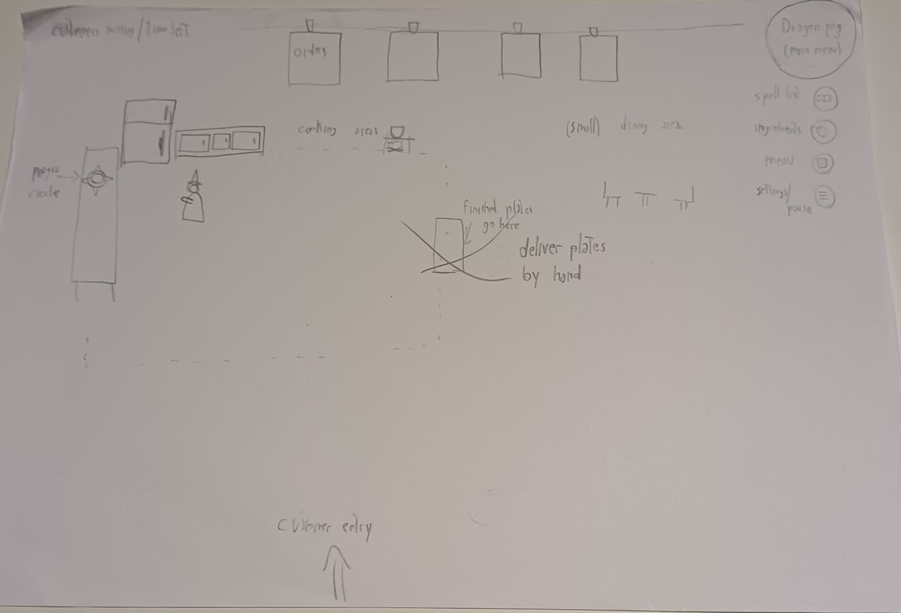
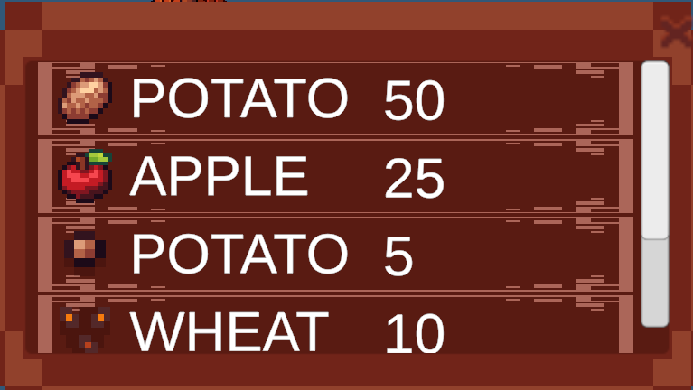

# Overview and vision statement

## Introduction

_At Azzy's_ is a 2D TopDown pixel-art management and role-playing game for PC. The player takes the role of an apprentice mage who must keep the village tavern running after its owner has been transformed into a tiny dragon.

## Description

In _At Azzy's_ the player must manage the tavern and help the original owner, Azzy, return to human form. To run the tavern the player uses spells in many different ways: to grow ingredients in the tavern garden and to cook for the townsfolk. Not every ingredient can be grown in the garden, so the player will visit the village market to buy additional ingredients and unlock new recipes for the tavern.

In-game days are divided into two gameplay segments:

- Morning / Afternoon — This segment focuses on garden care and market visits and is intended to be cozy and relaxing. The player can harvest crops planted earlier, choose which seeds to plant, visit the market, and browse the recipe book to decide which ingredients are needed for specific dishes. New recipes are not all available at the start; the player unlocks them over time by progressing through the game and the recipe book. There is no time limit during this segment: the tavern only opens when the player decides to open it.

- Evening — The evening begins when the player opens the tavern. This segment is a fast-paced cooking phase in which the player must prepare food for customers before they become dissatisfied and leave. The player takes orders, prepares dishes, and serves townsfolk within limited time, earning gold for successful service. Orders include only recipes that can be prepared with the player’s current resources. A day ends when either the player runs out of ingredients or a fixed number of guests have entered the tavern. Cooking heavily involves creative use of spells, since they can be used from a distance, which makes multitasking a crucial part of the gameplay.

Spells are fundamental and are used for both farming and cooking. Example spells include:

- grow spell
- water spell
- fire spell
- cut spell

Their specific uses in gameplay are described in later sections of this document.

Azzy, in dragon form, accompanies the player throughout the adventure. Azzy serves as the player’s mentor, provides advice, assists during the tavern’s opening hours, and functions as the in-game tutorial during the first minutes of gameplay.

# Characters

Below is a list of all the characters and character groups that will be present in the game and what their role will be:

- ### Azkoonn (Azzy)
  Azkoonn has been the tavernkeeper of "At Azzy's" for decades, but he was now suddently turned into a tiny dragon by a mysterious hooded figure.
  Even if he may look small, his temper did not change one bit: he is still kind to every customer and ready to help Luke to the best of his abilities.
  His role will be the one of a mentor, teaching Luke how to tend to his garden and how to serve amazing meals to the customers.
- ### Luke (Main Character)
  They were an apprentice learning the art of spellcasting under the guidance of a wizard who lives in a tower in the nearby city, but once he discovered that the beloved town's tavern would close they stepped up and became the new tavernkeeper.
  Under the guidance of Azkoonn they will manage the tavern and find a way to turn Azkoonn back to his human self.
- ### Shopkeepers
  These characters reside in the village square, each one selling their hard earned wares:
  - Sophie, a pretty saleswoman who sells seeds that his husband produces.
  - Michael, a young and hopefull fisherman who sells the fish he catches.
  - Hugo, a big middle-aged man who butchers animals for other people.
  - Rose, An old sweet farmer lady that can only manage to tend to their animals, selling eggs and dairy products.
    Their role is to provide otherwise unobtainable ingredients to Luke and immerse them in the village life.
- ### Customers
  These are the townfolk that will come in during the dinner shift at the tavern and order there.
  Their role is to immerse the player into the village life with short dialogue boxes which can be personalized for each customer, who could return after a couple of days.

# Story

Slyfall is a small village, located in a long and narrow valley, well known throughout for the high morale of his townfolk.
You are an apprendice mage, commuting everyday to study the tomes at the tower of the prestigious Thorin, a powerful mage who lives next town over.
While passing through Slyfall you are used to greet everyone, including Azkoonn, the tavernkeeper, who was usually tending to his crops in the back, but today the sight was different: a hooded figure burst out of the tavern and disappeared into the nearby forest, you rush into the tavern to find that Azkoonn has been turned into a tiny dragon!
Not even Azkoonn knows who did it, but not "At Azzy's" must close down since he cannot cook food or tend to the garden like this, which is where you step in!
Thorin always said that practice is what makes you learn the fastest, so which better opportunity to use your spells then cooking with them.
A lot of challenges await, will you manage to grow your own ingredients and keep the tavern going? Will the crops wither away or flourish once again? Who would ever want to inflict a curse on the beloved small town tavernkeeper?
Legends say that there exists a recipe capable of dispelling any curse, will you be able to discover it and cook it?

# World Design / Scenery

## Overview

This section describes all scenes of At Azzy's; the world is divided into three main scenes: Tavern, Garden, and Market.
Each scene has its own characteristics detailed in the table below:

- In the tavern the player is able to cook food with ingredients and to sell it to customers, by using the kitchen.
- The Garden supports the farming gameplay and depicts a field which is framed by fences.
- The Market provides the trading functionality with several shops.

A detailed description of the gameplay is available in the Gameplay section. Generally speaking, each scene should express a cozy and relaxed atmosphere. The color palette and lightning is warm and pastel to underline the cozy feeling of the world. On top on that, the sound design and visual details support the mood with relaxing music and vegetation.

## Scenes

| Scene      | Gameplay Role             | Objects                                                                    | Composition                    | Mood & Emotion        | Colors                    | Lighting      | Sound                  | Environment Details           |
| ---------- | ------------------------- | -------------------------------------------------------------------------- | ------------------------------ | --------------------- | ------------------------- | ------------- | ---------------------- | ----------------------------- |
| **Tavern** | Cooking & selling<br>food | Cooking station, chairs,<br>tables, cupboards, shelves,<br>pots, customers | Split: kitchen & customer area | Magical, rustic, cozy | Warm, pastel,<br>low sat. | Warm, relaxed | Music & cooking sounds | —                             |
| **Garden** | Farming                   | Crops, fences                                                              | Fences frame crops             | Cozy                  | Warm, pastel,<br>low sat. | Daylight      | Music & farm SFX       | Trees, grass,<br>fruits, pond |
| **Market** | Trading area              | Houses, Shops (seeds,<br>fish, meat, dairy), Library, Roads                | Aligned side by side           | Cozy                  | Warm, pastel,<br>low sat. | Daylight      | Music                  | Trees, grass                  |

## Tavern - scenic composition



# Gameplay

## General Gameplay Elements

**Movement**: The player will be able to move using the WASD keys. There is no need for additional movement (like jumping or running)

**Interactions**: The player can interact with objects by clicking them with the mouse. Sometimes the player might need to be on the tile next to the object to interact with it.

**Inventory**: A simple inventory system is necessary. This can be achieved with a UI element that opens when pressing the **B** key or by clicking on a small bag icon on the screen. (The game is too short to expect the player to remember all the keys; a small icon on the screen can help if they get confused.)

**UI Elements**: A spell UI element that tells the player which key to press for each spell, There will be a small hotbar containing the spells avaliable to the player.

**Selector UI** element indicates the current seed or ingredient selected. With the mouse scroll wheel, the player can change the selected item. This helps minimize the number of times the player opens the inventory.

---

## Spells

- The spells can be used with the number keys **1–4**, probably with a toggle system rather than a “hold to use” system.
  All the spells can be directed with the mouse.

### Technical Spell Infrastructure

This section will described how spells and objects that interact with them have been implemented. Since they are a core gameplay element, they must be implemented in a scalable and easily modifiable way. For this reason, we decided to use the following design pattern for how to create new object that interact with spells:

- **_[Template Pattern](https://refactoring.guru/design-patterns/template-method)_**

Template Method is a behavioral design pattern that defines the skeleton of an algorithm in the superclass but lets subclasses override specific steps of the algorithm without changing its structure. This seems like a perfect fit for our case.

The explanation will be divided in three subsections:

- Spells and projectiles
- Spell casting
- Interactable objects

There are four different types of spells. These are being handled by the _SpellEnum.cs_ file, which includes the following kinds of spells:

- FIRE
- WATER
- GROWTH
- CUT
- NONE

The _NONE_ enum must be used only for initialization and default operations when needed.

#### Spells and projectiles

In _At Azzy's_, the spell system will be implemented in two ways:

- as projectiles shot from the player to the cursor position
- with a "point and click" mechanic

The final decision on the implementation will be taken further on into implementation. In the meantime, through a _Serializable Field_ in the _Unity Inspector_ one can easily switch through the two implementations.

Either ways, objects that spells can interact with will need to be able to be highlighted, so the player knows which objects will react to spells. The highlighting will be handled in the following subsection.

**Projectiles style spells**

For the projectile implementation, a Unity Prefab will be needed to instantiate new projectiles when needed. The Prefab's name can be found in the appropriate folder under the name _Spell_.

Below can be found all the components essential for the correct functioning of spell projectiles.

<p align="center">

</p>

- _Sprite Renderer_: note that a prefixed sprite has been selected, but it will change based on the code. In _additional settings_, we want the _Sorting Layer_ to be _Player_ with an order equal to $-1$, so that the spell will begin its travel from below the player.

<p align="center">

</p>

- _RigidBody 2D_: this component is crucial to handle the correct interaction with objects. Note that the _Gravity Scale_ is set to zero, otherwise balistic will come into play.
- _Capsule Collider_: this is also crucial for the correct interaction with other objects. The _Is Trigger_ checkbox must be ticked, this way the spell will be compenetrable, but will launch an event when interacting with specific objects.

<p align="center">

</p>

- _Spell Projectile_ this is a MonoBehaviour component which has various settings. _Ttl_ indicates how much time (in seconds) must pass before the spell gets destroyed if it does not hit anything. The _Spell sprites_ section requires references to the sprites of each kind of spell. Fallback solutions are implemented if these are missing.

In the future, spells might also have animations, the prefab and its component will be modified accordingly.

#### Spell casting

The casting of spells will be handled by a single script called _SpellCaster.cs_. This component must be attached to the player.

This component handles the casting of spells, from the pressing of the keys, up until the instantiation of the projectiles or interaction with a highlighted object.

Below is shown the component in the _Unity Inspector_.

<p align="center">

</p>

- _Interactable Layer_: this is the layer in which all objects that will interact with the spells must reside. A custom _Magic Interactable_ layer has been added for this specific purpose.
- _Spell Settings_: it handles various settings: switching between the two spell implementation, asking for a reference for the spell prefab, fine tuning the spell projectile maximum speed and acceleration.
- _Spell Keys_: it offers the opportunity to modify the keys that need to be pressed to cast the various spell.
- _Game Camera_: asks for a reference to the game camera in order for the correct functioning of the aiming and selection system.

#### Interactable objects

Interactable objects will implement the factory design pattern. An interface called _ISpellInteractable_ has been created and must be included to all classes that want to have interactions with spells.

A sample prefab for these type of objects has been created. It can be found in the appropriate folder under the name _SpellInteractabeObject_.

This prefab includes a main object and a empty child object. This is used to handle the highlighting feature.

A similar structure can be implemented also for objects the player interacts without the use of spells.

Below can be found all the components essential for the correct functioning of spell interactable objects. More components can be added, but these are the essential ones.

<p align="center">

</p>

- _Layer_: the object must reside in the _Magic Interactable_ layer. This is essential, since spells will only interact with objects in this layer.
- _Sprite Renderer_: this is used to show the sprite of the object.

<p align="center">

</p>

- _Collider 2D_: can be any type of collider, box is recommender for its low computational needs. _Is Trigger_ must be left unchecked so the player cannot trepass the object.
- _Spell Target Object_: script that implements the various interactions that an object can have with the spells.
- _Highlitable_: script that handles the highlighting of the object while the player hovers it with the cursor.

In order for the object to be highlightable, the object prefab must have an empty child exactly named **_Highlight_** otherwise it will not work properly. Here are the component of the child.

<p align="center">

</p>
<p align="center">

</p>

- _Sprite Renderer_: it must include the sprite for the highlighting. Another essential setting is the _Sorting Layer_, which must be the same as the object, and the _Order in Layer_, which must be set high, so that the highlight will always appear on top of the highlighted object.

#### UML diagram

Here can be found a simple UML diagram, which explains how the spell infrastructure works and how the different components interact with each other.

<p align="center">

</p>

All the references to the various components can be found in the previous subsections.

---

## Inventory System

The inventory system is composed of 2 parts: the main inventory panel and the quick inventory panel.

The quick inventory panel represents the currently selected item from the inventory. It can be considered as a single slot with 2 buttons for switching selections, while the main inventory consists of 36 slots. Each slot stores one type of item and displays the item's icon along with its quantity (when the amount is greater than 1). The selected slot is highlighted in the main inventory. When the inventory is open, character movement is disabled.

**Main Interfaces/Functionalities:**

- **Dropping Items**: Users can press X to drop items. Items are dropped in front of the character based on their facing direction (up, down, left, or right) and a configurable drop distance. Other programmers can adjust this distance in the Unity Inspector when selecting the character in the Hierarchy window. The implementation uses `PlayerItemController::DropItem(Collectable item)`. Since there's only one PlayerItemController, other components can access it through `FindObjectOfType` or `GameObject.FindGameObject` and call this function.

- **Collecting Items**: Characters can collect items of the Collectable class through collision detection. This functionality is handled by the `OnTriggerEnter2D(Collider2D collision)` method in the Collectable class. This method can be extended for farming mechanics - for example, by adding a condition to check if a "cut" spell is used on a collectible item.

- **Opening/Closing Inventory**: Press the "I" key to toggle the inventory panel. When the panel is active, users can also close it using the ESC key or the "X" button.

- **Switching Selection**: There are 2 ways to change inventory selection:

  1. Clicking the left or right buttons in the quick inventory panel
  2. Clicking directly on the desired slot in the main inventory

- **Collectable Objects**:
  The collectable objects refers to the objects that can be put into inventory, therefore since there are objects in 4 category(NONE,FOOD, SEED, GREDIENTS) and multiple different types(APPLE, POTATO,MEAT,etc). And one type can have different types,for example, there will be prefabs of potato in form of seed and in form of gredient.
  To configure collectible items for the inventory, modify the corresponding prefabs by changing their sprites and types. Then, add new **prefabs under a file called Prefabs**(not the ones on the scene) to the "Collectable Items" list in the ItemManager script attached to the "Manager" GameObject under the "Inventory System" hierarchy.

<p align="center">

<p align="center">

</p>

- **Item Manager**

The `ItemManager` is responsible for generating a dictionary containing all collectable objects:

```csharp
Dictionary<string, Collectable>
```

The **key** is a string formatted as:

```
"{Category} - {Type}"
```

For example: `"SEED - POTATO"` or `"FOOD - MEAT"`.

This system allows for fast lookup of collectable prefabs based on their type and category.

There are also two important **private lists** inside the `ItemManager` that control whether items from certain categories can be picked up or dropped:

- `List<CollectableCategory> NoCollisionCategory`  
  Prevents items in certain categories from being collected via collision.

- `List<CollectableCategory> NoDroppableCategory`  
  Prevents items in those categories from being dropped by the player.

#### UML diagram

<p align="center">

</p>

## Dialogue System

The dialogue system is used to run welcome dialogues in each scene and to handle interactions with NPCs or environmental objects (such as doors).  
Our implementation is based on the plugin from https://github.com/Wafflus/unity-dialogue-system, but we have **extended its functionality** to support calling custom functions directly from dialogue choices.

To open the dialogue editor window, go to **Window → DS → Dialogue Graph**.

<p align="center">

</p>
<p align="center">

</p>

Before using this system, make sure the **DialogueSystem**, **Editor**, and **Editor Default Resources** folders are created under the **Assets** directory.

<p align="center">

</p>

### Creating Dialogues

To create dialogue content within the dialogue graph, right-click anywhere in the graph window and choose either a **Single Selection** or **Multiple Selection** node.  
Configure the dialogue text, selection options, and node connections to define the dialogue flow.

Click **Save** to store your work.

- The dialogue container will be saved as **DSDialogueContainerSO**
- Each dialogue node will be saved as **DSDialogueSO**  
  Saved files are located in:  
  **Assets/DialogueSystem/Dialogues/FarmToTavernTrigger**

To edit an existing dialogue, click **Load** and select the dialogue file.

### Assigning Dialogues to NPCs

To assign a dialogue to an NPC or other object, attach the **NPCDialogueTrigger** script and a **Box Collider 2D** set to _Is Trigger_.  
When the player enters this collider area, the assigned **DSDialogueContainerSO** will play starting from its initial **DSDialogueSO** node.

### Extended Feature: Calling Functions from Dialogue Choices

We have extended the original dialogue plugin to support **function calls from dialogue choice selections**.  
Each option can trigger custom functions through the **On Choice Events** panel:

- The first event slot corresponds to the first option.
- The second event slot corresponds to the second option, and so on.

This allows dialogues to directly influence gameplay logic, trigger animations, update quest states, or perform any custom behavior.

<p align="center">

</p>
<p align="center">

</p>

## Shopping System

The shopping system allows the player to buy seeds and ingredients from a NPC via a GUI (Shop Panel). The shop panel
displays a list of items available for purchase, each with its icon, name and price. It can be simply appended to any
NPC to make it a shopkeeper.

<p align="center">

</p>

### Main Interfaces/Functionalities:

- **Shop Items**: Each shop item is represented by a button in the shop panel. The ShopManager can be used to easily
  add items to the shop by specifying a `ShopItem`. Latter is simply a wrapper of a `Collectable` with an
  additional price field. So if we drag a `Collectable` prefab into the `Item` field of `Item to Give` in the inspector of
  `ShopItem` and define a price, then it can be sold in the shop for the specified price by inserting it in the `Items For
Sale` list of the ShopManager.
- **Buying Items**: The player can buy items by clicking on the corresponding item button in the shop panel.
  If the player has enough money, the item is added to their inventory, and the cost is deducted from their total money.
- **Opening/Closing Shop Panel**: The shop panel can be opened by pressing "F" next to a shopkeeper NPC. It can be
  be closed again by pressing "F" or clicking the close button in the panel.

<p align="center">


</p>

### UML Diagram

<p align="center">

</p>

## Money System

The money system allows the player spend money throughout the game. The player starts with a predefined amount of money,
which can be defined in the `PlayerStats.cs`. The current amount of money is displayed in the UI at all times.

<p align="center">

</p>

### Technical Money Implementation

- **Player Stats**: The `PlayerStats` class manages the player's money. It provides methods to spend money and check if
  the player has enough money for a transaction. The starting amount of money can be set in the inspector.
- **Money Display**: The `MoneyDisplay` class is responsible for updating the money display in the UI. It listens for
changes in the player's money and updates the UI text accordingly.
<p align="center">

</p>

## Farming Gameplay

During the morning, the player is able to collect all the ingredients for the meals. The player can travel between two different screens: **the Farm** and **the Market**.

**The Market** is structured as a market square where the player can interact with some NPCs and market stalls to buy seeds, meat, fish, and dairy products. Interacting with NPCs triggers dialogues and brings up a UI element with the list of purchasable items. The player can buy items only if they have enough money.

**The Farm** is structured as a garden with some farming tiles. By interacting with these tiles, the player can plant seeds. The plants need to be watered with the **water spell**, and their growth can be sped up with the **growth spell**. If these two spells are used, the plants will be fully grown by the next day (this allows the vertical slice to be completed in about 20 minutes). The crops can be harvested with the **cut spell**.

During the first day (the tutorial), the player will be taught how to plant, water, and grow the plants.
At the start of the second day, the market is unlocked.

---

### Technical Farming Implementation

This section will describe in detail how the farming system is implemented; given the different amount of seeds that can be planted and different ways in which the plants could grow (differing by time and/or by spell needed to grow) this system has to be implemented in a highly scalable way
Note that all of the following requirements will hold only for the

The explanation will be divided in these subsections, which will nicely follow the lifecycle of a seed in our game:

- Seeds and their interaction with spells
- Planting seeds
- Seed growth
- Harvesting seeds

#### Seeds and their interaction with spells

Seeds will need to be stored in the player inventory
Each type of vegetable that can be grown will have his own different seed, which will either be in the initial stock of the game or be able to be bought at the town's market
Seeds will use the _SpellInteractabeObject_ prefab as a base, since they need to have interaction as spells
For each new type of seed there is a prefab that is called name-seed that is placed in the Assets/Prefabs/Farm/Seed directory
It needs to have the following components attached to properly work

<p align="center"> 

</p>
*Name:* The name needs to be exactly [VegetableName]-Seed for logic that is used inside of these classes
*Layer:* The layer must be *Magic interactable* since the seeds needs to interact with the spells
*Seed script:* This class contains values that will need to change in most seeds, even tho the contents of Spells needed and growth days can be considered the standard, expectially for this vertical slice, while the other fields need to be set as follows:
* *Growth Sprites* needs to be a list of size growth days + 1 and contains the seed sprites at different growth stages, in this example it contains the image of the seed barely sprouting and then the seed being fully grown
* *Drop Object* needs to contain the collectible prefab that will be dropped when the crop is correctly harvested

<p align="center"> 

</p>
*Sprite Renderer*: The sprite renderer is needed to visualize the state of the seed to the player, it needs to be set to the first growth sprite
*Capsule Collider 2D*: This component is just used to detect collision between this object and spells, it can be made of any shape and can have any offset and could even have is_trigger = False if we dont want the character to be able to walk through them, this can be adjusted on a case to case basis

#### Planting seeds

In order to plant seeds, they need to be able to get into the inventory as special items with _Category_="SEED"
So every different seed type must have a collectible item for its seed form, even if they may never get picked up for the player (they are going to get bought, not picked up from the ground)
These Prefabs are in the Assets/Prefabs/Farm/Collectibles/Seed directory with these components:

- _Sprite rendered:_ To be able to visualize the seed, it needs to be set to the seed sprite for the given crop
- _Box Collider 2D:_ This needs to be here in order for the player to be able to pick the seeds up in case they drop them
- _Collectible script:_ The Category needs to be SEED in order for it to be planted, while the type should be the exact same as the one used in the seed prefab

There is also a need for a script to handle all of the functionalities of actually planting a seed and checking when and where it is appropriate to do so; for this reason the character prefab now has the _Seed Planter_ script attached to it

<p align="center"> 

</p>
* *Maximum planting distance:* This is the maximum Vector2 distance between the center of the tile and the position of the player that is considered valid for planting
* *Game Camera:* This is a reference to the active game camera
This script also needs the *FarmingHighlight* Prefab present in the scene and the *PlantingAvailable* Prefab as a child of the character game object

#### Seed Growth

Seed growth works in the following way: At the end of the day, the _EndOfDay_ function will get called, which will then see which seeds have the correct growth requirements
These requirements are the spell required by every seed (the standard is 1 water and 1 growth spell)
If one seed is hit by all the required spells, it will grow to its next stage upon the start of the next farming stage
This code is handled by the _FarmingManager_ script of the _Farming Manager_ game object

<p align="center"> 

</p>
The only important thing about the parameters of this script is that everytime a new seed is created it must be dragged and clicked into the *Seeds* list, otherwise the player wont be able to plant it
This is also the script that implements the EndOFDay function mentioned before, and the script that mostly all farming related scripts reference and call to keep a unified state

#### Harvesting Seeds

When a seed is at his final growth stage and the cut spell is used on it, the collectible prefab indicated in the seed script will get dropped onto the ground and be ready for pickup
This is done as a simple _Instantiate_ function call, and can easily support animations and/or multiple drops per crop

#### UML Diagram

Below is the UML diagram of the farming system

<p align="center"> 

</p>

---

**List of interactable elements** that need to be implemented:

- NPCs and market stalls
- UI elements
- Farming tiles
- Seeds and plants
- Unwanted bushes that can be burned (might not be implemented)

---

### Spells in Farming

- **Grow Spell**: Speeds up the growing process to one day. Maybe for more sophisticated plants, it takes longer.
- **Water Spell**: Waters the plants and allows them to grow.
- **Fire Spell**: Burns bushes to make space for new plants. If used on your own plants, it burns them.
- **Cut Spell**: Allows harvesting the crops.

## Cooking System - Gameplay

The cooking system serves as the core gameplay mechanic, integrating **movement control**, **spellcasting**, **order management**, and **time pressure** to create an immersive tavern management experience. Players must utilize spells to complete customer orders within time limits for generous rewards.

### Technical Cooking Infrastructure

This section will describe how cooking and cooking stations work and how they can be easily implemented. Since they revolve around a core game mechanic, they must be implemented in a scalable and easily modifiable way. For this reason, we decided to adopt the same design pattern adopted for the spells:

- **_[Template Pattern](https://refactoring.guru/design-patterns/template-method)_**

Template Method is a behavioral design pattern that defines the skeleton of an algorithm in the superclass but lets subclasses override specific steps of the algorithm without changing its structure. This seems like a perfect fit for our case.

The explanation will be divided in the following sections:

- Player-side interactions
- Abstract Cooking station
- Enums
- Example: Boiling Station

For now, all visual feedbacks are just changing-color sprites. Further down development, animations and such should be implemented.

#### Player-side Interactions

In order to interact with cooking stations, the player requires a specific Monobehaviour component called _PlayerCook.cs_. This script allows the player to interact if within a certain distance. Such distance is set as a serializable field, so can be tuned as preferred.

This script also handles the highlighting of cooking stations. This works by activating and deactivating a highlight object when the player gets close to a cooking station. Its prefab must be referenced to the player in order for the highlighting to work properly.

Here is shown the _PlayerCook.cs_ component.

<p align="center">

</p>

#### Abstract Cooking Station

As explained in the Template Pattern, we need an interface or an abstract class in order for it to work. We opted for the abstract class. This choice was made so that it was possible to define specific attributes and methods common to all cooking stations, though still leaving place to override certain methods.

Here are explained all attributes and methods of the _AbstractCookingStation_ class:

- **Ingredient Settings**

  - `acceptedIngredients`: A list of ingredient types that can be placed in the station.
  - `CookingSlots`: A list of the ingredients currently inside the station.
  - `CookingRecipes`: A dictionary that defines the recipes. It maps a list of ingredients to the final product.
  - `OutputSlot`: Contains the cooked food, ready to be picked up by the player.

- **Cooking Bar Settings**

  - `doneThreshold`: The value the cooking bar must reach to complete the process.
  - `isDiscrete`: If `true`, the cooking bar advances in steps; otherwise, it advances continuously.
  - `CookingBarValue`: The current progress value of the cooking process.
  - `CurrentVelocity`: The current speed at which the cooking bar is changing.
  - `cookingVelocity`: The base speed at which the cooking bar increases when the station is active.
  - `cookingDeceleration`: The rate at which the cooking bar decreases when the station is no longer active.
  - `minNegativeVelocity`: The minimum (negative) speed at which the bar can decrease.

- **Cooking Station Settings**

  - `CurrentState`: The current state of the station (e.g., `RESTING`, `COOKING`, `DONE`).
  - `spellsNeededToWork`: A list of spells required to activate and operate the station.
  - `_spellHistory`: Stores the sequence of spells cast on the station.

- **UI Settings**

  - `cookingBarSlider`: The UI `Slider` component that displays the `CookingBarValue`.
  - `itemCloud`: A `GameObject` that acts as a container to display the ingredient or product icon.
  - `itemSpriteImage`: The `Image` component that shows the item's sprite.
  - `spriteRotationSpeed`: The speed at which ingredient icons rotate when there is more than one.

- **Helper Fields**

  - `itemManager`: A reference to the `ItemManager` to get item data like sprites.
  - `spriteRotationCoroutine`: A reference to the coroutine that handles the rotation of sprites in the `itemCloud`.

- `TryToAddIngredient(player)`: Attempts to take an ingredient from the player's inventory and add it to the station.
- `OnSpellHit(spellType)`: Handles the logic that activates when a spell hits the station.
- `UpdateCookingBar()` / `UpdateCookingBarDiscrete()`: Update the value of the cooking bar, either continuously or in discrete steps.
- `SetCookingSlot(ingredient)`: Adds an ingredient to the cooking slots.
- `GetOutputSlot()`: Returns the type of item present in the output slot.
- `ResetOutputSlot()`: Empties the output slot and resets the station.
- `ResetStation()`: Returns the station to its initial state, clearing ingredients, the cooking bar, and spell history.
- `CookingReady()`: A function called when the cooking process is completed.
- `CheckRecipes(givenIngredients)`: Checks if the provided ingredients match a valid recipe and returns the corresponding product.
- `UpdateVisualFeedback()`: Updates the user interface to show the current ingredients or the finished product.
- `RotateSprites(sprites)`: A coroutine that handles the rotation animation of the item icons in the `itemCloud`.

The implementations of these methods can be modified in the specific implementation of a cooking station using the _override_ keyword. Further methods can always be added if needed.

All implementations of cooking stations must extend this class, so to keep the architecture clear and easily modifiable.

#### Enums

New enums have been added to the codebase.

**_CookingStationStateEnum_**: this one encorporates the current state of a cooking station:

- RESTING: signals that the cooking station does not have any ingredient in the CookingSlots or in the OutputSlot. It is the beginning state of every station.
- READY: signals that either is ready for cooking or some ingredients have been put inside the station.
- COOKING: signals that the cooking is being performed through spells, when the station is in this state, the Cooking bar is being visualized
- DONE: signals that the food is ready to be picked up by the player
- NONE: shuold be used for initializations only

**_CollectableCategory_**: Here the Ingredient and Food categories have been added. Ingredients are those that can be put inside of cooking stations or that can be picked out (some cooking stations will be used to prepare mid-recipe ingredients). Food instead represents what has to be served.

**_CollectableType_**: here should be added all kinds of new ingredients or food.

#### Example: Boiling Station

The first cooking station to be developed is the Boiling Station. This one had the objective of cooking boiled potatoes.

Here is shown the list of components a cooking station should have:

<p align="center">

</p>

- _Collider 2D_: make sure that _Is Trigger_ is off, so that the player cannot pass over it. It is necessary for the correct handling of spells.
- _RigidBody 2D_: the body type has been set ot static since it should not be moved. It is also essential for the correct handling of spells.

<p align="center">

</p>

- _Boiling Station (Script)_: here all the serializable fields from the abstract class can be set and tuned. Their explanation was done in the second subsection.

Notice that the dictionary of _CookingRecipes_ is not in here. This is due to Dictionaries not being serializable in Unity. This means that recipes must be hardcoded. Workarounds like creating a custom serializable can be done in the future.

Another way to handle this problem is to create a class recipe, which has all needed data in order to handle its working. This way, the dictionary would become a list, which can be serialized.

In order to correctly handle the visual feedbacks of the station, each one of them should have the following structure (this can also be found in the Boiling Station Prefab):

<p align="center">


</p>

- _Canvas_: a Unity canvas, which contains all visual elements of the cooking station
- _CookingBar_: handles the correct visualization of the Cooking bar
- _ItemCloud_: shows the current CookingSlot on rotation or the OutputSlot, depending on the current state of the station.

#### UML diagram

Here can be found a simple UML diagram, which explains how the cooking infrastructure works and how the different components interact with each other.

<p align="center">

</p>

All the references to the various components can be found in the previous subsections.

### 2. Order Management System

- **Order Acceptance Process**: Customers wait in the reception area, players take their orders before their wait time runs out
- **Order Interface**: Real-time display at the top of the screen:
  - Unique customer portrait
  - Specified dish requirements
  - Preparation countdown (customer leaves if timeout)
- **Multitasking**: Supports handling multiple orders simultaneously
- **Delivery**: The player will hand deliver each order to the correct customer

### Technical Order System implementation

This section will describe how orders and recipe work behind the scenes
This will be devided in the following subsections:

- Order Management
- Recipe handling
- Order UI

For now this section does not use animations: these can be implemented further down the line

#### Order Management

The order management system is handled by the _OrderManager_ prefab, with the _OrderManager.cs_ script, it must be present in any scene where the player should cook

<p align="center">

</p>

The SerialibleFields are explained as follows:

- Recipes: The list of recipes that the player could be offered to cook
- Order Prefab: Contains the prefab of the UI element for the order so it can be spawned in the scene
- Order Parent: Contains the position of the Order Canvas
- Is Prototype: Boolean that is true if the order manager is working in the prototype mode, false otherwise
- Prototype Recipe: The only recipe that will be offered to the player during the prototype

The order system works in the following way: For now it will spawn a single order and create a new one whenever that order expires or is completed
The recipe that is chosen depends on different factors, if _isPrototype_ is set to true, it will only create orders for the _prototypeRecipe_ set in the inspector, since in the prototype players will be given only one recipe at a time, while if _isPrototype_ is set to false the script will look in the player inventory for any ingredients and then it will select one random recipe that has all of its ingredients in their inventory
An order is completed when the matching item is added to the inventory: instead of getting added to the inventory it will furfil the oldest order with that item

#### Recipe handling

Due to their nature, recipes are implemented using unity's scriptable object system
Below is an example recipe and the explanation of all of the fields

<p align="center">

</p>

- Ingredient Needed and Amount Needed: these 2 lists combine to create a _Dictionary< CollectibleType, Integer>_ containing all of the ingredients that are needed to make the recipes and in which amount
- Order Time: Time in seconds that the order will take to timeout
- Image: Sprite that will be shown in the order UI
- Money: Amount of money that will be awarded to the player for completion of an order
- FoodType: _CollectableType_ that identifies which collectible item to look for when completing an order (NOTE: I can check this since all food items have a unique name that does not appear with _CollectibleCategory_ seed or ingredient)

For now there is no distinction between recipes that can appear in an order and intermediate recipes (like flour) but a simple boolean can fix that

#### Order User Interface

This is a tentative order user interface for the orders
It holds a customer image (which does not change for the prototype) and the image for the recipe being asked by the order
It also has a timer bar right below to indicate how much time you have left

<p align="center">

</p>

---

### 3. Spell System

- **Control Method**: Number keys (1/2/3/4) combined with the mouse position to control the range of the spells
- **Spell System**:
  - **Fire Spell**: Exclusive to stone stoves, used for boiling and roasting
  - **Water Spell**: Provides water filling, dough mixing, and fire extinguishing functions
  - **Cut Spell**: Processes ingredients, completing cutting and grinding tasks
  - **Growth Spell**: Creates ingredient enlargement effects

---

## Progressive Game Progression

### Phase One: Basic Tutorial (First Day)

**Teaching Objective**: Master the basic cooking operation cycle

**Guidance Content**:

- Dragon guides the opening of first day operations
- Step-by-step tutorial through "Baked Potatoes" recipe:
  - Fire spell to bake the potato
  - Cut spell to open up the potato
- Core mechanism learning:
  - Order acceptance and interface recognition
  - Safe stove usage standards
  - Understanding delivery mechanisms
- Enter settlement after serving fixed customer flow

### Phase Two: Advanced Challenges (Second Day)

**Progression Goal**: The player will learn the impact of his decisions from the previous day (amount of money earned and crops planted).

**New Content**:

- The market will open up, allowing the player to buy new recipes
- The recipe book will be given to the player, highlighting missing ingredients to unlock new recipes

**System Deepening**:

- Importance of variety in crop planting
- Multitasking coordination will be needed for the cooking part

---

## Interactive Environment Design

### 1. Kitchen Area Division

- **Stone Stove Area**: Only safe zone permitted for heating operations
- **Wood Preparation Area**: Dedicated to ingredient preprocessing, prohibits placing hot utensils
- **Operation Standards**: All ingredient processing must be completed on counters

### 2. Safety Management System

- **Heating Restrictions**: Fire spell only activates on stone stoves or fireplaces
- **Fire Warning**: Hot utensils or fire spells contacting wooden surfaces trigger fires
- **Emergency Handling**: Water spell can extinguish fires promptly

---

## Strategic Planning System

### Cooking Efficiency Optimization

- **Order Sequencing**: Determine priority based on urgency and reward value
- **Space Utilization**: Reasonably allocate counter resources for parallel operations
- **Pathway Design**: Optimize routes for ingredient retrieval, processing, and cooking

---

## Interface and Feedback System

### 1. Real-time Status Display

- **Task Status**: Real-time updates of player and dragon assistant task progress
- **Resource Occupancy**: Visually displays stove usage status

### 2. Contextual Operation Guidance

- **Skill Prompts**:
  - Highlight fire spell when approaching stoves
  - Display placement key when holding ingredients
  - Prompt cut spell when ingredients are on wooden counters
  - Indicate water spell during fire emergencies
- **Order Warnings**: Special highlighting for urgent orders
- **Safety Alerts**: Trigger warnings when hot utensils contact danger zones

---

## VIII. Recipe System

Example recipes:

### 1. Baked Potatoes

- **Description**: Basic tutorial dish, mastering the usage of spells
- **Required Ingredients**: Potatoes
- **Cooking Steps**:
  1. Take potatoes from ingredient menu
  2. Place potato in the **stone oven**, use **Fire Spell** to bake it
  3. Use plate to retrieve the potato
  4. Place on **wooden counter** and use **Cut Spell** to pen up the potato
  5. Serve to customer

### 2. Pan-Seared Steak

- **Description**: Main course testing heat control mastery
- **Required Ingredients**: Steak
- **Cooking Steps**:
  1. Place steak on **stone stove** frying pan
  2. Use **Fire Spell** to pan-sear
  3. Control timing for desired doneness
  4. Plate and serve to customer

---

## Core Design Goals

### Experience Focus

- **Operation Precision**: Accurate coordination of movement and spellcasting
- **Spatial Awareness**: Efficient utilization of kitchen layout
- **Process Optimization**: Efficiency maximization under constraints

### Difficulty Balance

- **Operation Depth**: Enhanced technicality through movement control
- **Strategic Dimension**: Delivery limitations foster tactical choices
- **Safety Standards**: Dedicated stoves improve operational accuracy requirements
- **Timing**: Timely orders reward extra money, waiting too much will lead to customers leaving

# Technical Specification

## Controls

At Azzy's is a PC game played with keyboard and mouse. The player moves using the **WASD** keys; the mouse and additional keyboard keys are used to interact with objects, cast spells, and cook. The game is developed specifically for keyboard and mouse because the mouse’s fast movements are critical for managing multitasking during the cooking segment. Adapting the controls for gamepads or other controllers can be considered later, but it is not a development priority.

### Rebindable controls

Priority for rebindable controls is optional and can be implemented later; it is not a development priority for the initial build. When implemented, players should be able to remap any keyboard key and mouse button used for gameplay, including movement, interact, hotbar slots, spells and menu actions. The system should support saving and loading control profiles and include a “Restore defaults” option. The in-game UI for this feature should be a simple keybinding screen that shows clear prompts and warns the player about conflicting bindings.

### Mouse settings

Mouse settings are also optional and can be added later. When exposed, settings should include a sensitivity slider that affects cursor and aim responsiveness and a way to change cursor size (either a slider or small/medium/large options). Because mouse precision is central to cooking and multitasking gameplay, these options are recommended for the polished build to give players more control over aiming and cursor behavior.

### Saving the game

The game should autosave at key points to minimize lost progress: at the start of each in-game day (after the morning setup is complete), at the end of each in-game day (after the evening service completes) and at regular time periods. A manual save option should be available from the pause menu and create a manual save slot. When the player quits the game it should resume from the most recent autosave or from the last manual save; if the player quits during an evening shift, the evening should resume from the last autosave so progress prior to the current evening is not lost. To improve robustness, keep a small number of backup autosave files (for example the last three autosaves), show clear save timestamps in the load menu, and prompt the player before overwriting manual save slots.

---

# Deadlines

## 02/12/2025

All features for the prototype must be implemented and documented in the GDD:

- Cidar: Create an UI for the spells to aid player with controls; create the images that explain to the player how to grow seeds and create recipes; get the new cursor sprite and substitute it to the regular one
- Francesco: Build the scenes for the prototype; create colliders for the edge of the farm scene (and tavern if needed); necessary sprite work
- Gabriel: finish up the order system for the prototype; implement system to switch between different recipes in the tavern scenes and system to make a day pass in the farming scene
- Laya: Implement a dialogue system with welcome text and explanations for stuck players; make the trigger to go from the farm scene to the tavern scene
- Lorenzo: Implement the new recipes; implement background noice and sound effects into the game

## 11/11/2025

- Cidar: The cooking station system is explained in this GDD and is merged into main; the needed mechanics are: being able to interact with the cooking stations with both ingredients and spells, both the boiling and the cutting interaction systems
- Gabriel: The farming system is explained in this GDD and is merged into main; the needed mechanics are: Being able to plant different types of seed, interact with them via spells, gather the grown plants, interaction with the inventory system

## 07/11/2025

- Lorenzo: The spell system is explained on this GDD and is merged into main; the needed mechanics are: scalable interaction between spells and objects, spell projectiles, highlighting of certain objects while under the mouse, spell animation when hit
- Laya: The inventory system is explained on this GDD and is merged into main; the needed mechanics are: collecting objects from the ground, quick inventory system to spawn items, "big" insventory to visualize collected items, having basic functions to make other parts of this project interact with the inventory system

## 03/10/2025

- Gabriel: The initial GDD and the base project are pushed to main

## 21/10/2025

Everyone has to finish their assigned part of the GDD

- Lorenzo: Technical Specification, Overview and vision statement
- Laya: Gameplay (cooking part)
- Francesco: Gameplay (farming part)
- Gabriel: Characters, Story
- Sidar: Scenery

## 31/10/2025

- Everyone will experiment on unity projects similar to ours (2d top down)
