<style>
  /* Custom styles for Markdown PDF export */

  h1 {
      font-size: 32px !important;
      font-weight: bold !important;
      color: #1a1a1a !important;
      border-bottom: 3px solid #333333 !important;
      padding-bottom: 10px !important;
      margin-top: 30px !important;
      margin-bottom: 20px !important;
  }

  h2 {
      font-size: 28px !important;
      font-weight: bold !important;
      color: #2d2d2d !important;
      border-bottom: 2px solid #666666 !important;
      padding-bottom: 8px !important;
      margin-top: 25px !important;
      margin-bottom: 15px !important;
  }

  h3 {
      font-size: 24px !important;
      font-weight: bold !important;
      color: #3d3d3d !important;
      border-left: 4px solid #555555 !important;
      padding-left: 12px !important;
      margin-top: 20px !important;
      margin-bottom: 12px !important;
      background-color: #f8f8f8 !important;
      padding-top: 8px !important;
      padding-bottom: 8px !important;
  }

  h4 {
      font-size: 20px !important;
      font-weight: bold !important;
      color: #4d4d4d !important;
      border-left: 3px solid #888888 !important;
      padding-left: 12px !important;
      margin-top: 18px !important;
      margin-bottom: 10px !important;
  }

  h5 {
      font-size: 18px !important;
      font-weight: 700 !important;
      color: #5d5d5d !important;
      border-left: 2px solid #aaaaaa !important;
      padding-left: 12px !important;
      margin-top: 15px !important;
      margin-bottom: 8px !important;
  }

  h6 {
      font-size: 15px !important;
      font-weight: 500 !important;
      color: #808080 !important;
      border-left: none !important;
      border-bottom: 1px dotted #cccccc !important;
      padding-left: 0px !important;
      padding-bottom: 4px !important;
      margin-top: 12px !important;
      margin-bottom: 8px !important;
      font-style: italic !important;
  }

  body {
      font-size: 14px !important;
  }


  /* Beautiful table styling */
  table {
      border-collapse: collapse !important;
      width: 100% !important;
      margin: 20px 0 !important;
      box-shadow: 0 2px 4px rgba(0,0,0,0.1) !important;
  }

  th {
      background-color: #2c3e50 !important;
      color: white !important;
      font-weight: bold !important;
      padding: 12px 15px !important;
      text-align: left !important;
      border: 1px solid #34495e !important;
      font-size: 14px !important;
  }

  td {
      padding: 10px 15px !important;
      border: 1px solid #ddd !important;
      text-align: left !important;
      font-size: 13px !important;
  }

  tr:nth-child(even) {
      background-color: #f9f9f9 !important;
  }

  tr:hover {
      background-color: #f5f5f5 !important;
  }

  /* First column emphasis (optional) */
  td:first-child {
      font-weight: 600 !important;
  }

  /* Prevent page breaks inside other elements */
  ul, ol, p, pre, blockquote {
      page-break-inside: avoid !important;
  }

  img {
      page-break-inside: avoid !important;
  }

  hr {
      border: none !important;
      height: 1px !important;
      background-color: #ddd !important;
      margin: 20px 0 !important;
  }

  code {
      background-color: #f4f4f4 !important;
      color: #c7254e !important;  /* Dark pink/red text */
      padding: 2px 6px !important;
      border-radius: 3px !important;
      font-family: Consolas, Monaco, 'Courier New', monospace !important;
      font-size: 13px !important;
  }

</style>

# **AT AZZY'S**

## **Overview and vision statement**

### **Introduction**

_At Azzy's_ is a 2D TopDown pixel-art management and role-playing game for PC. The player takes the role of an apprentice mage who must keep the village tavern running after its owner has been transformed into a tiny dragon.

### **Description**

In _At Azzy's_ the player must manage the tavern and help the original owner, _Azzy_, return to human form. To run the tavern the player uses spells in many different ways: to grow ingredients in the tavern garden and to cook for the townsfolk. Not every ingredient can be grown in the garden, so the player will visit the village market to buy additional ingredients and unlock new recipes for the tavern.

In-game days are divided into two gameplay segments:

- Morning / Afternoon — This segment focuses on garden care and market visits and is intended to be cozy and relaxing. The player can harvest crops planted earlier, choose which seeds to plant, visit the market, and browse the recipe book to decide which ingredients are needed for specific dishes. New recipes are not all available at the start; the player unlocks them over time by progressing through the game and the recipe book. There is no time limit during this segment: the tavern only opens when the player decides to open it.

- Evening — The evening begins when the player opens the tavern. This segment is a fast-paced cooking phase in which the player must prepare food for customers before they become dissatisfied and leave. The player takes orders, prepares dishes, and serves townsfolk within limited time, earning gold for successful service. Orders include only recipes that can be prepared with the player’s current resources. A day ends when either the player runs out of ingredients or a fixed number of guests have entered the tavern. Cooking heavily involves creative use of spells, since they can be used from a distance, which makes multitasking a crucial part of the gameplay.

Spells are fundamental and are used for both farming and cooking. Example spells include:

- grow spell
- water spell
- fire spell
- cut spell

Their specific uses in gameplay are described in later sections of this document.

Azzy, in dragon form, accompanies the player throughout the adventure. Azzy serves as the player’s mentor, provides advice, and functions as the in-game tutorial during the first minutes of gameplay.

## **Characters**

Below is a list of all the characters and character groups that will be present in the game and what their role will be:

- ### Azkoonn (Azzy)
  _Azkoonn_ has been the tavernkeeper of _At Azzy's_ for decades, but he was now suddently turned into a tiny dragon by a mysterious hooded figure.
  Even if he may look small, his temper did not change one bit: he is still kind to every customer and ready to help _Luke_ to the best of his abilities.
  His role will be the one of a mentor, teaching _Luke_ how to tend to his garden and how to serve amazing meals to the customers.
- ### Luke (Main Character)
  They were an apprentice learning the art of spellcasting under the guidance of a wizard who lives in a tower in the nearby city, but once he discovered that the beloved town's tavern would close they stepped up and became the new tavernkeeper.
  Under the guidance of _Azkoonn_ they will manage the tavern and find a way to turn _Azkoonn_ back to his human self.
- ### Shopkeepers
  These characters reside in the village square, each one selling their hard earned wares:
  - _Sophie_, a pretty saleswoman who sells seeds that his husband produces.
  - _Michael_, a young and hopefull man who sells recipes.
  - _Hugo_, a big middle-aged man who butchers animals for other people.
  - _Rose_, An old sweet farmer lady that can only manage to tend to their animals, selling eggs and dairy products.

Their role is to provide otherwise unobtainable ingredients to Luke and immerse them in the village life.

- ### Customers
  These are the townfolk that will come in during the dinner shift at the tavern and order there. Their role is to immerse the player into the village life.

## **Story**

Slyfall is a small village, located in a long and narrow valley, well known throughout for the high morale of his townfolk.
You are an apprendice mage, commuting everyday to study the tomes at the tower of the prestigious _Thorin_, a powerful mage who lives next town over.
While passing through Slyfall you are used to greet everyone, including _Azkoonn_, the tavernkeeper, who was usually tending to his crops in the back, but today the sight was different: a hooded figure burst out of the tavern and disappeared into the nearby forest, you rush into the tavern to find that _Azkoonn_ has been turned into a tiny dragon!
Not even _Azkoonn_ knows who did it, but now _At Azzy's_ must close down since he cannot cook food or tend to the garden like this, which is where you step in!
_Thorin_ always said that practice is what makes you learn the fastest, so which better opportunity to use your spells then cooking with them.
A lot of challenges await, will you manage to grow your own ingredients and keep the tavern going? Will the crops wither away or flourish once again? Who would ever want to inflict a curse on the beloved small town tavernkeeper?
Legends say that there exists a recipe capable of dispelling any curse, will you be able to discover it and cook it?

## **World Design / Scenery**

### **Overview**

This section describes all scenes of _At Azzy's_; the world is divided into three main scenes: Tavern, Garden, and Market.
Each scene has its own characteristics detailed in the table below:

- In the tavern the player is able to cook food with ingredients and to sell it to customers, by using the kitchen.
- The Farm supports the farming gameplay and depicts a field which is framed by fences.
- The Market provides the trading functionality with several shops.

A detailed description of the gameplay is available in the Gameplay section. Generally speaking, each scene should express a cozy and relaxed atmosphere. The color palette and lighting is warm to underline the cozy feeling of the world. On top on that, the sound design and visual details support the mood with relaxing music and vegetation.

### **Scenes**

| Scene      | Gameplay Role             | Objects                                                                    | Composition                    | Mood & Emotion        | Colors                    | Lighting      | Sound                  | Environment Details           |
| ---------- | ------------------------- | -------------------------------------------------------------------------- | ------------------------------ | --------------------- | ------------------------- | ------------- | ---------------------- | ----------------------------- |
| **Tavern** | Cooking & selling<br>food | Cooking station, chairs,<br>tables, cupboards, shelves,<br>pots, customers | Split: kitchen & customer area | Magical, rustic, cozy | Warm. | Warm, relaxed | Tavern upbeat Music & cooking sounds | —                             |
| **Farm** | Farming                   | Crops, fences                                                              | Fences frame crops             | Cozy                  | Warm. | Daylight      | Chill Music & farm SFX       | Trees, grass,<br>fruits, pond |
| **Market** | Trading area              | Houses, Shops (seeds,<br>recipes, meat, dairy), Roads                | Around a square           | Cozy and medieval-like                  | Warm. | Daylight      | Chill Music                  | Houses, stalls, fountain, plaza                  |

### **Tavern - scenic composition**

<p align="center">
  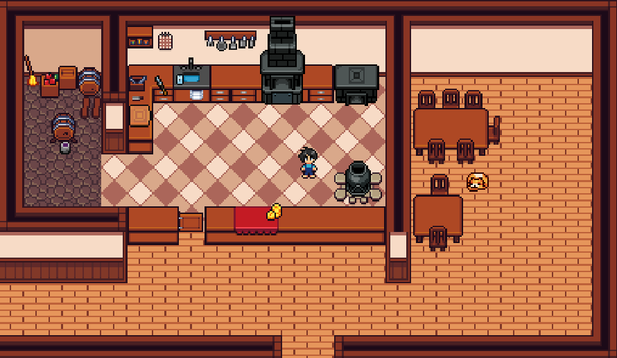
</p>

### **Farm - scenic composition**

<p align="center">
  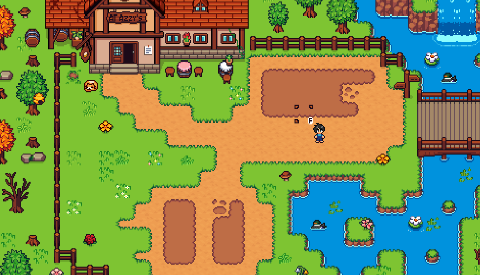
</p>

### **Market - scenic composition**

<p align="center">
  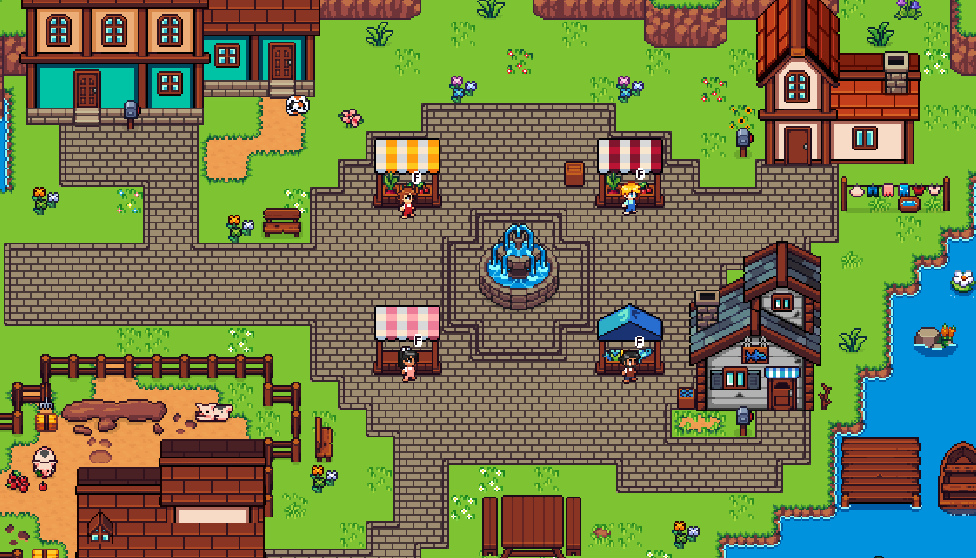
</p>

## **Gameplay**

### **General Gameplay Elements**

**Movement**: The player will be able to move using the `WASD` keys. There is no need for additional movement (like jumping or running)

**Interactions**: The player can interact with objects by pressing `F` next to the thing/NPC they want to interact with.

**Inventory**: A simple inventory system is necessary. This can be achieved with a UI element that opens when pressing the `I` key or by clicking on a small bag icon on the screen. An item can be selected from the inventory by pressing on its icon. This serves as the held item for the player. A "quick inventory" is always shown on screen, displaying the held item and the ones next to it in the inventory. The held item can also be switched by pressing `Q` and `E`.

**Spells**: The player can cast spells by clicking on the mouse with the cursor. A custom cursor is made for the game and the spell will be a projectile moving towards the direction of it. When spells hit something, an animation and SFX will play to give feedback to the player. In order to select which kind of spell to cast, the player can use `1`, `2`, `3`, `4` keys or use the mouse scroll wheel to iterate through them. A hotbar showing the buttons and the selected spell will be part of the UI.

**Dialogue**: The player can start a dialogue by interacting with an NPC. Then a dialogue box will appear and the player can go to the next part of the dialogue by pressing `SPACE` or `ENTER`. Some dialogues require choices, like when talking to a shopkeeper they ask you if you want to buy something or not.

**Money**: The game has a coin counter on screen. Coins can be gathered by selling food to customers in the tavern. Different food leads to different amount of coins. Then, they can be spent in the market buying groceries or new recipes.

**Menu and Settings**: The menu can be accessed by pressing `TAB` or clicking the pause icon. In it there can be found many buttons:
* `RESUME`: resumes the game. This can be also done by pressing `TAB` again.
* `SETTINGS`: opens the settings menu, where the player can adjust the volume of music and SFX.
* `RESET TUTORIAL`: resets the tutorial keys, so that the player can replay the tutorials.
* `QUIT`: closes the game.
* `UNLOCK FINALE`: unlocks the finale of the game and gives the player all the items necessary to complete it. Since the aim of the game is for it to be a 20 minutes slice of the complete game and the finale should require quite some time to reach, a shortcut to play the finale was added.

**Music**: The game always has some background music and some SFX. Different scenes have their own background music. Different actions have their own SFX: walking, cooking, failing or succeding at a recipe, buying and picking up items. Special background music was reserved for the finale.

**Recipe Book**: The player is not expected to remember all recipes, so a recipe book serves the purpose. It can be accessed by pressing `B` or by clicking the book icon. This book stores all the recipes, showing locked and unlocked ones (locked ones are blacked out) and explaining what is required to prepare them.

**UI**: there are many UI elements in the game and they all serve their unique purpose which was explained above:
* Coin Counter
* Pause Icon
* Inventory Icon
* Book Icon
* Spells Hotbar
* Quick Inventory

<p align="center">
  
</p>

### **Farm Gameplay Elements**

**Farming**: In the farm there are specific tiles reserved for planting. In order to obtain a crop, the player must:
* plant a seed in the soil: this can be done by having a seed as the held item and by pressing `F` next to a soil tile. When getting close to it, a highlighter of the tile will appear with the correct button to press.
* cast spells: the player must cast both the Water Spell and the Growth Spell in any order towards the seed. The first is necessary to water the soil, the second is necessary to make the crop grow fast. With the last one, the crop will grow in one day, otherwise it will never grow.
* wait one day: the only way to go the next day is to go into the tavern and spend the night after the tavern shift.
* gather the crop: once grown, the player can collect the food after having used the Cut Spell on it. This will make the plant disappear and will leave the food on the ground, ready to be picked up by walking on it.

<p align="center">
  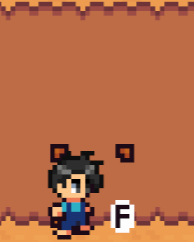
  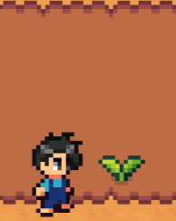
  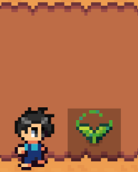
  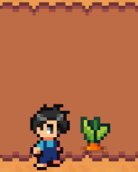
  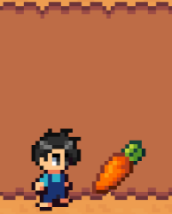
</p>

**Shopping**: In the market area, the player can buy goods from the shopkeepers:
* _Sophie_ (seeds): sells seeds, which can then be planted in the farm
* _Hugo_ (meat): sells steak and fish, which can be used for cooking
* _Rose_ (animal derivates): sells animal products like milk, cheese and eggs, which can be used for cooking
* _Michael_ (recipes): sells new recipes, which allow the player to cook new food in the tavern. When buying a new recipe, the corresponding one in the recipe book will be unlocked.

<p align="center">
  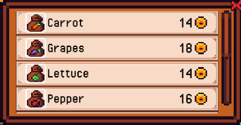
</p>

### **Tavern Gameplay elements**

**Recipe Menu**: Each time the player enters the tavern, a book-like UI will open, this is the menu for the night. With this UI, the player can decide which recipes to prepare for the night, and the orders that will come will include only the selected recipes. Each recipe can be selected or deselected by clicking on it and a special button for selecting all is present. Only recipes for which the player has the ingredients in the inventory can be selected.

<p align="center">
  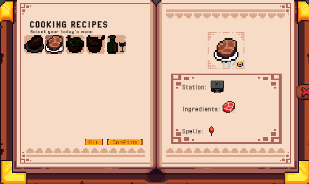
</p>

**Orders**: During the night, many customers can enter the tavern and they will order something from the menu. The NPC will walk into the tavern and stop by the counter with a cloud on their head expressing their order. At the same time, also a UI element expressing the order will pop up on top of the screen along with a slider serving as a timer. The order is successful if the player manages to deliver the food to the customer on time, otherwise it fails. In order to deliver the food, the player must interact with the counter while having as held item the requested dish. When successfully delivering an order, the player will gain some coins based on the specific recipe. The number of orders per shift are randomized, and no orders will appear and the day will end if the player does not have any more ingredients to cook any recipe.

<p align="center">
  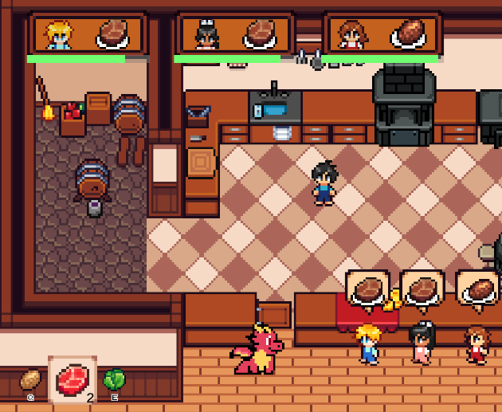
</p>

**Cooking Stations**: These are the places where the player can cook food. Different recipes might require different cooking stations, and some might require that the food gets elaborated by more than one station. In order to insert the food into the station, the player must interact with the station while holding the ingredient to put in. The ingredients present in the station are shown rotating in a cloud on top of the station. If the current ingredients lead to a recipe the player has unlocked, the cloud will turn green, otherwise it will be red. If a player cooks something that does not lead to an unlocked recipe, the cooking station will return a special `TRASH` item, which will be thrown away after the cooking shift. If the player wants to retrieve the ingredients from the station, they can interact with `R` and the ingredients will go back into the player's inventory. Different cooking stations require a different type of interaction to work:
* **Boiling Station**: in order to work, the player must insert the ingredients and then use the Water Spell to fill it with water. After doing this, the player must keep the fire alive using the Fire Spell. Then a slider will gradually fill in, but if the player has not hit the station with the Fire Spell in a while, the slider will start going backwards. The food is successfully cooked when the slider is full.
* **Stove Station**: after inserting the ingredients, the player must keep the fire alive by using the Fire Spell on it. The interaction works similarly to the Boiling Station.
* **Keg Station**: after inserting the ingredients, the player must fill the keg with water using the Water Spell. After doing this, the player must use the Growth Spell on it a certain number of times. Unlike with the previous stations, the slider does not go backwards, a specific number of hits must be performed in order to prepare the food in the keg.
* **Cutting Board**: after inserting the ingredients, the player must use the Cut Spell a certain number of times on the cutting board. The interaction works similarly to the Keg Station.
* **Oven Station**: after inserting the ingredients, the player must start the fire by using the Fire Spell. Contrary to the Boiling Station and the Stove Station, there is no need to keep the fire alive, one cast is enough. Then the slider will appear and a "blue" and "red" zone will be highlighted on it. The "blue" zone refers to the correct cooking zone, if the player stops the cooking process in this zone, the food will be cooked perfectly. In order to stop the cooking process, the player must cast the Water Spell. On the other hand, if the player stops the cooking process in the "red" zone, the food will be burnt and a special `BURNT` item will be put out. This item will be thrown away automatically after the shift in the tavern. Finally, if the player stops the cooking process before the "blue" or "red" zone, the slider will simply stop and the player will need to start the fire again to continue.

<p align="center" width="90%">
  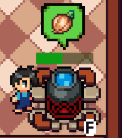
  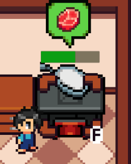
  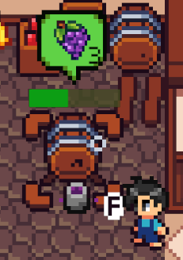
  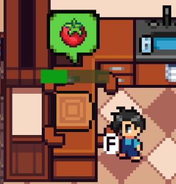
  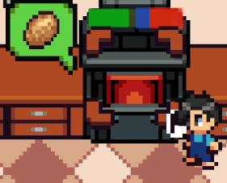
</p>


**Recipes**: There are different recipes in the game, some of them are unlocked from the very beginning, other will be unlocked when bought from the market. The recipes and their preparations are shown down here:
| Recipe Name | Ingredients | Money | Station |
|-------------|-------------|-------|---------|
| Baked Potato | Potato x1 | 24 | Oven Station |
| Bread | Flour x1, Cheese x1 | 72 | Oven Station |
| Cake | Flour x1, Cheese x1, Egg x1, Strawberry x1 | 305 | Oven Station |
| Cooked Fish | Raw Fish x1 | 120 | Stove Station |
| Cooked Steak | Raw Steak x1 | 104 | Stove Station |
| Fish And Salad | Cooked Fish x1, Lettuce x1 | 180 | Cutting Board |
| Fish Soup | Carrot x1, Pepper x1, Onion x1, Cooked Fish x1 | 245 | Boiling Station |
| Flour | Wheat x1 | 20 | Cutting Board |
| Meatballs | Tomato Sauce x1, Raw Steak x1 | 385 | Stove Station |
| Pizza | Tomato Sauce x1, Flour x1, Cheese x1, Cheese x1 | 480 | Oven Station |
| Rainbow Burrito | Bread x1, Tomato Sauce x1, Fish And Salad x1, Egg x1, Cheese x1, Milk x1, Cooked Steak x1 | 1350 | Cutting Board |
| Rainbow Essence | Carrot x1, Pepper x1, Onion x1, Lettuce x1, Grapes x1, Strawberry x1, Strawberry x1 | 35 | Keg Station |
| Salad | Grapes x1, Lettuce x1 | 56 | Cutting Board |
| Sandwich | Bread x1, Cheese x1, Lettuce x1, Grapes x1 | 340 | Cutting Board |
| Tomato Sauce | Tomato x3 | 92 | Keg Station |
| Vegetable Soup | Carrot x1, Onion x1, Pepper x1 | 84 | Pot Station |
| Wine | Grapes x3 | 118 | Keg Station |

### **Progression Gameplay Elements**

All progression elements are directly linked to automatic dialogues with the dragon Azzy. Furthermore, all progression elements are fault proof, if the player tries to break the progressions in any way, the game will redirect the player on the correct tracks.

#### **CutScene**

At the beginning of the game, when first opening it, a cutscene will be shown to the player. This serves as an introduction to the story and the plot of the game.

The cutscene shows how Azzy got transformed into a dragon and introduces the story.

#### **Tutorials**

Tutorials are introduced to the player when first opening the game in order to teach them all the basic mechanics of the game. Tutorials can be reset by the corresponding button in the menu.

**Farming Tutorial**: it explains the player all they need to know about farming. Its structure is the following:
1. _Azzy_ explains how he got transformed into a dragon and why he needs the help of the player
2. There already is a grown crop in the garden
3. _Azzy_ teaches the player the use of the Cut Spell to harvest the crops
4. _Azzy_ teaches the player how to plant a seed and how to prepare it to grow through the use of the Water Spell and the Growth Spell
5. _Azzy_ invites the player to now enter the tavern

**Cooking Tutorial**: It triggers after entering the tavern after completing the farming tutorial. It explains the player all they need to know about cooking. Its structure is the following:
1. _Azzy_ welcomes the player to the tavern and introduces the cooking mechanics
2. **Baked Potato Recipe**:
   - The player is given a potato
   - _Azzy_ guides the player to place it in the oven
   - The player learns to use the Fire Spell to start cooking
   - The player learns to use the Water Spell to stop cooking at the right moment (avoiding burning)
   - If the potato burns, _Azzy_ explains the mistake and allows a retry
   - Once successfully cooked, the player collects the baked potato
   - A tutorial customer appears requesting the baked potato
   - The player delivers the dish at the counter and receives gold
3. **Cooked Steak Recipe**:
   - _Azzy_ introduces cooking with the stove
   - The player is given a raw steak
   - The player places it in the stove
   - The player learns to cast the Fire Spell multiple times to maintain heat
   - Once cooked, the player collects the steak and serves it to a tutorial customer
4. **Salad Recipe**:
   - _Azzy_ introduces the cutting board station
   - The player is given lettuce and tomato
   - The player places both ingredients on the cutting board
   - _Azzy_ teaches a tip: pressing `R` while focused on a station retrieves all ingredients back to inventory
   - The player learns to use the Cut Spell three times to chop the ingredients
   - If the player attempts to complete the recipe with missing ingredients, _Azzy_ explains the error and allows a retry
   - Once prepared, the player collects the salad and serves it to a tutorial customer
5. **Tutorial Completion**:
   - _Azzy_ mentions the existence of two additional cooking methods (boiling and fermenting) for future exploration
   - _Azzy_ reminds the player to monitor cooking progress and use appropriate spells
   - _Azzy_ informs the player that new recipes will be discovered throughout the game
   - _Azzy_ gives bonus ingredients as rewards (5 potatoes, 2 raw steaks, 4 lettuce, 4 tomatoes)
   - _Azzy_ reminds the player about the recipe book accessible with the `B` key
   - The tutorial ends and normal gameplay begins with customer orders enabled

**Shop Tutorial**: It triggers after ending the day in the tavern after the cooking tutorial. It explains the player all they need to know about purchasing items from the shop. Its structure is the following:  
1. _Azzy_ congratulates the player on their farming and cooking skills  
2. _Azzy_ explains that not all ingredients can be found on the farm or in the wild  
3. _Azzy_ introduces the shop located east of the tavern where items can be purchased  
4. _Azzy_ explains that items are bought using gold earned from selling meals  
5. _Azzy_ expresses hope that an ingredient might be found to break the curse  
6. The player is instructed to talk to the shopkeeper  
7. The player is prompted to purchase any item from the shop  
8. Upon completing a purchase, _Azzy_ concludes the tutorial

#### **Finale**

The Finale represents the culmination of the player's journey, triggered after purchasing the Rainbow Essence and Rainbow Burrito recipes from the shop. This finale sequence guides the player toward preparing the dishes needed to break _Azzy_'s curse.

Its structure is the following:

**Farm Finale**:

1. **Recipe Discovery**:
   - _Azzy_ notices the player has acquired the Rainbow recipes
   - _Azzy_ reveals these recipes are legendary and said to have curse-lifting powers

2. **Ingredient Requirements**:
   - _Azzy_ explains that preparing these special dishes requires gathering specific ingredients:
     - 1 Carrot
     - 1 Pepper
     - 1 Onion
     - 2 Lettuce
     - 4 Tomatoes
     - 1 Grape
     - 1 Strawberry
     - 1 Wheat
     - 1 Egg
     - 1 Cheese
     - 1 Milk
     - 1 Raw Fish
     - 1 Raw Steak
   - _Azzy_ reminds the player that the ingredient list can be reviewed anytime in the recipe book (accessible with `B` key)

3. **Finale Preparation**:
   - Once all ingredients are collected, _Azzy_ and the player will prepare the Rainbow Burrito together
   - This marks the beginning of the final sequence to break the curse


**Cooking Finale**:

1. **Finale Introduction**:
   - Once all ingredients are collected, the cooking finale automatically triggers
   - The menu does not appear and no orders will come up
   - Special finale background music begins playing

2. **Rainbow Essence Preparation**:
   - _Azzy_ explains the first step: preparing the Rainbow Essence using the keg
   - Required ingredients: 1 carrot, 1 pepper, 1 onion, 1 lettuce, 1 tomato, 1 grape, and 1 strawberry
   - Upon successful completion, _Azzy_ acknowledges the magical power of the essence

3. **Rainbow Burrito Components**:
   - The player must prepare several intermediate recipes:
     - **Bread**: Made from flour and egg (if not already prepared)
     - **Tomato Sauce**: Made from tomatoes (if not already prepared)
     - **Fish and Salad**: Combining cooked fish with salad (if not already prepared)
     - **Cooked Steak**: Properly cooked steak (if not already prepared)
   - _Azzy_ guides the player through each component, checking if items are already prepared
   - The player can reference the recipe book at any time using the `B` key

4. **Final Assembly**:
   - Once all components are ready, _Azzy_ instructs the player to assemble the Rainbow Burrito at the cutting board
   - Required components: 1 bread, 1 tomato sauce, 1 fish and salad, 1 cooked steak, 1 milk, 1 cheese, and 1 rainbow essence
   - Upon successful completion, the player collects the Rainbow Burrito

5. **The Transformation**:
   - _Azzy_ asks the player to bring the Rainbow Burrito to them
   - The player delivers the burrito by interacting with _Azzy_
   - A magical transformation sequence occurs:
     - A white magical circle surrounds _Azzy_
     - _Azzy_ transforms from dragon to human form
     - The circle disappears
     - Ending music begins playing

6. **Finale Resolution**:
   - _Azzy_ expresses overwhelming gratitude for being freed from the curse
   - As a token of gratitude, _Azzy_ gifts the tavern to the player
   - A success screen is displayed, marking the completion of the main storyline

**Failure Condition**:
- If the player fails any recipe during the finale (producing `BURNT` or `TRASH` food), the finale fails and the player must retry when gathering all the ingredients again and a failure screen appears

## **Media List**

### **Graphical Assets**

Many of the graphical assets of the game come from the [*Tiny Farm RPG*](https://emanuelledev.itch.io/farm-rpg) Asset Pack.
The cooking stations assets come instead from the [*Pixel Crawler*](https://anokolisa.itch.io/free-pixel-art-asset-pack-topdown-tileset-rpg-16x16-sprites) Asset Pack.

Slight modifications have been done to some assets to best fit into the game.

These asset pack consisted of:
* Sprites
* Animations
* Tiles

The majority of the food assets have been done by hand.

### **Audio Assets**

All of the audio assets of the game come from the website [*OpenGameArt.com*](https://opengameart.org/). Slight modifications have been done to best fit those into the game. 

The sound used includes:
* Background Music
* Sound Effects (SFX)

## **Technical Specification**

### **World Design: Tilesets and Layers**

#### Tilemap Architecture

The game utilizes **Unity's Tilemap system** with a multi-layered approach organized through **Sorting Layers** to create depth and proper rendering order.

#### Sorting Layer Hierarchy

The world is rendered using the following sorting layers (from back to front):

1. **Background** - Furthest visual elements
2. **Floor** - Base ground tiles and carpets
3. **Walls** - Wall structures and boundaries
4. **Decorations** - Environmental props and furniture
5. **Seed** - Farmable plants and crops
6. **Collectible** - Items and collectables
7. **Player** - Player character
8. **OnTopOfPlayer** - Overhead elements (roofs, trees)
9. **UI** - User interface elements

#### Tileset Structure

The game employs multiple themed tilesets for different environments:

##### Outdoor Environments
- **Grass Cliff Tileset** - Natural terrain with cliff edges
- **Bridge Tileset** - River crossings and pathways
- **Tree Tileset** - Foliage and natural decorations
- **Grass Props** - Additional environmental details

##### Indoor Environments
- **Tavern Interior Tileset** - Indoor tavern furniture and walls
- **Kitchen Tileset** - Cooking area props and equipment
- **Market Tileset** - Market stalls and vendor decorations

#### Rule Tiles Implementation

The game uses **Unity Rule Tiles** for intelligent auto-tiling:

- **GrassRuleTile** - Automatic grass edge blending with custom neighbor rules
- **PathRuleTile** - Self-connecting pathway generation
- **WaterRuleTile** - Dynamic water edge transitions
- **SoilRuleTile** - Farmable soil area management
- **FenceRuleTile** - Automatic fence connections
- **TownPath** - Urban pathway connections

#### Special Tilemaps

- **SoilTileMap** - Interactive farming layer on the "Soil" physics layer, supports color tinting for watered states
- Dynamic tile animations for water and environmental effects

### **General Gameplay Elements**

#### **UI Technical Architecture**

##### UI Framework

The game is built using **Unity's UI system (uGUI)** with the following core components:
- **Canvas** with Screen Space Overlay rendering mode
- **Event System** for input handling and raycasting
- **TextMeshPro (TMP)** for all text rendering
- **CanvasGroup** for managing UI visibility and interactivity

##### Core UI Components

###### 1. Inventory System
**Implementation**: `Inventory_ui.cs`, `Slot_ui.cs`

**Features**:
- *Grid-based slot layout* with dynamic item display
- *Event-driven architecture* (`OnInventoryChanged` event)
- *Time pause* when inventory is open (`Time.timeScale = 0f`)
- *Click-to-select* item management with visual highlighting for the held item

**Technical Details**:
- Each slot contains an *Image* component for item icons
- *TextMeshProUGUI* for quantity display
- *Button* components with custom click listeners
- *Color-based selection feedback* (yellow tint for selected slots)

<p align="center">
  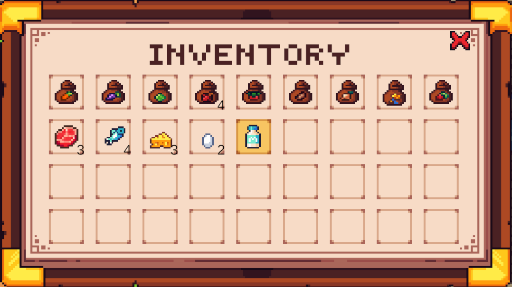
</p>


###### 2. Spell Hotbar
**Implementation**: `HotbarController.cs`, `SpellSlotHighlighter.cs`

**Features**:
- **4-slot spell selection** system (Fire, Water, Growth, Cut)
- **Number key and scroll wheel** input support
- **Dynamic highlighting** with color transitions
- **Tutorial-aware** highlighting system with custom colors

**Technical Details**:
- Uses **Image component color changes** for visual feedback
- Normal color: White

<p align="center">
  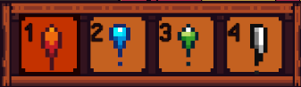
</p>

###### 3. Recipe Book UI
**Implementation**: `BookPanelUI.cs`, `RightPageUI.cs`, `CookingFormulaUI.cs`

**Features**:
- **Two-page layout** (left page: recipe icons, right page: details)
- **Dynamic background sprites** based on position (edge, middle variants)
- **Recipe unlock system** with event-driven updates
- **Ingredient and spell visualization** with icons and quantities

**Technical Details**:
- Grid-based layout for recipe icons (6 columns per row)
- Uses **Sprite swapping** for clicked/unclicked states

<p align="center">
  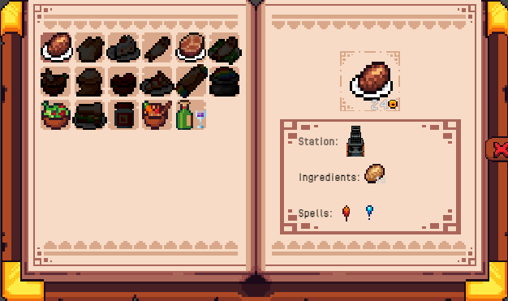
</p>

###### 4. Shop Interface
**Implementation**: `ShopPanelUI.cs`

**Features**:
- **Dynamic item generation** from ShopManager data
- **Recipe filtering** (hides already unlocked recipes)

<p align="center">
  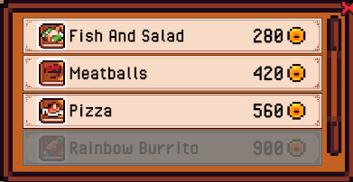
</p>

###### 5. Order Management UI
**Implementation**: `OrderManager.cs`, `Order.cs`

**Features**:
- **Real-time order display** with countdown timers
- **Customer visual representation** with queue system
- **Order completion animations** with fade effects
- **Counter slot** for placing finished dishes

**Technical Details**:
- Prefab-based order instantiation
- Parent-child transform hierarchy for positioning
- Coroutine-driven animation system

<p align="center">
  
</p>

###### 6. End of Day Screen
**Implementation**: `EndOfDayUI.cs`, `DayStats.cs`

**Features**:
- **Fade-in transition** with time slowdown effect
- **Statistics display**: day counter, customers served, orders completed/failed, money earned
- **Unscaled time coroutines** for consistent animation during time manipulation
- **CanvasGroup alpha blending** for smooth transitions

<p align="center">
  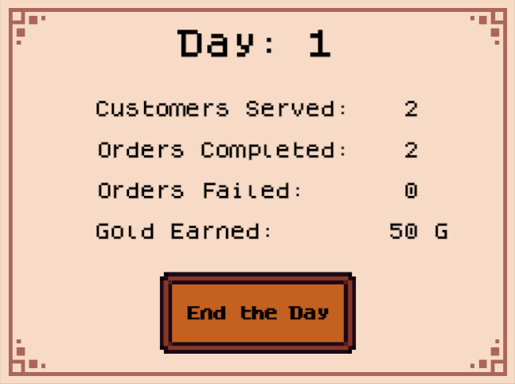
</p>

###### 7. Pause Menu System
**Implementation**: `PauseMenu.cs`, `SettingsMenu.cs`

**Features**:
- **Global singleton pattern** (persists across scenes via DontDestroyOnLoad)
- **Scene-aware HUD management** with automatic binding
- **Settings submenu** with volume sliders (music and SFX)

**Technical Details**:
- Uses **AudioManager integration** for volume control
- **Scene-loaded event subscription** for HUD rebinding
- **Time.timeScale manipulation** for pause state

<p align="center">
  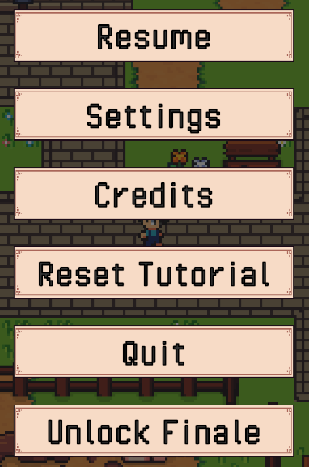
  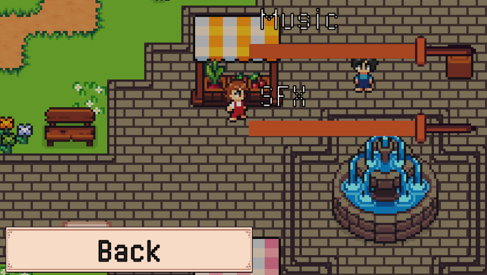
</p>

##### Input System Integration

All UI components respect the game's pause state:
```csharp
if (Time.timeScale == 0f) return;
```

#### **Pause Menu**

The *Pause Menu* system implements simple structures to handle the main objectives of a typical pause menu.

This section describes the implementation of the game's pause menu and settings interface. These systems must persist across scenes and manage game state globally, requiring careful architecture to handle scene transitions and HUD visibility.

The implementation uses the following design patterns:

- **_[Singleton Pattern](https://refactoring.guru/design-patterns/singleton)_**: Ensures a single, persistent pause menu instance across all scenes
- **_[Observer Pattern](https://refactoring.guru/design-patterns/observer)_**: Scene-loaded events trigger automatic HUD rebinding

The explanation is divided into two subsections:

- Pause Menu Architecture
- Settings Menu

##### Pause Menu Architecture

The pause menu system is managed by a global singleton that persists across scene transitions using Unity's `DontDestroyOnLoad` functionality. This is implemented in the **_PauseMenu.cs_** script, which must be attached to a GameObject in the **BootScene**.

<p align="center">

</p>

**Core Features:**
- Global game pause with time manipulation
- Scene-aware HUD visibility management
- Settings submenu integration
- Input handling for pause/resume

Below is the component configuration in the _Unity Inspector_:

<p align="center">
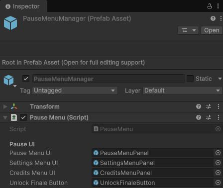
</p>

- **_Pause Menu UI_**: Reference to the main pause menu panel GameObject. This panel contains buttons for Resume, Settings, and other menu options.
- **_Settings Menu UI_**: Reference to the settings submenu panel. This is toggled separately from the main pause menu.
- **_Credits Menu UI_**: Reference to the credits submenu panel.
- **_Unlock Finale Button_**: Optional button reference for triggering the game's finale sequence (scene-specific).

**Input Handling**:
The system responds to the following inputs:
* `OpenMenu`: `TAB` key toggles pause state
* `Exit`: closes settings submenu if open

The pause menu checks the current game state before allowing pause:
* Prevents pausing in `BootScene`
* Respects existing UI panels (inventory, dialogues...)
* Saves and restores `Time.timescale` for nested time manipulations

##### Settings Menu

The settings menu is implemented in *SettingsMenu.cs* and provides audio control functionality. It uses Unity UI Sliders connected to the game's AudioManager singleton.

<p align="center"></img></p>

Components:
* **Music Slider**: Controls background music volume (0.0 to 1.0 range)
* **SFX Slider**: Controls sound effects volume (0.0 to 1.0 range)

**Technical Details:**
Each slider uses Unity's `onValueChanged` event to trigger audio updates in real-time:
```csharp
musicSlider.onValueChanged.AddListener(ifMusicVolumeChanged);
sfxSlider.onValueChanged.AddListener(ifSFXVolumeChanged);
```

##### UML Diagram

<p align="center">
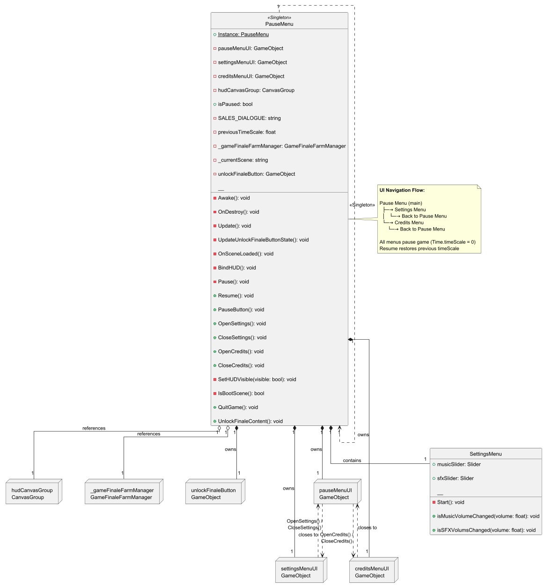
</p>

#### **Spells**

This section will describe how spells and objects that interact with them have been implemented. Since they are a core gameplay element, they must be implemented in a scalable and easily modifiable way. For this reason, we decided to use the following design pattern for how to create new object that interact with spells:

- **_[Template Pattern](https://refactoring.guru/design-patterns/template-method)_**

Template Method is a behavioral design pattern that defines the skeleton of an algorithm in the superclass but lets subclasses override specific steps of the algorithm without changing its structure.

The explanation will be divided in three subsections:

- Spells and projectiles
- Spell casting
- Interactable objects

There are four different types of spells. These are being handled by the `SpellEnum.cs` file, which includes the following kinds of spells:

- `FIRE`
- `WATER`
- `GROWTH`
- `CUT`
- `NONE`

The `NONE` enum must be used only for initialization and default operations when needed.

##### Spells and projectiles

In _At Azzy's_, the spell system will be implemented in two ways:

- as projectiles shot from the player to the cursor position
- with a "point and click" mechanic

The first method was chosen at last, but through a `SerializeField` in the Unity Inspector one can easily switch through the two implementations.

Either ways, objects that spells can interact with might need to be able to be highlighted, so the player knows which objects will react to spells. The highlighting will be handled in the following subsection.

**Projectiles style spells**

For the projectile implementation, a Unity Prefab will be needed to instantiate new projectiles when needed.

Below can be found all the components essential for the correct functioning of spell projectiles.

<p align="center">
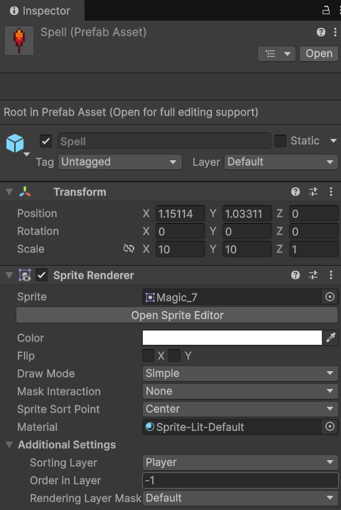
</p>

- `Sprite Renderer`: note that a prefixed sprite has been selected, but it will change based on the code. In `additional settings`, we want the `Sorting Layer` to be `Player` with an order equal to `-1`, so that the spell will begin its travel from below the player.

<p align="center">
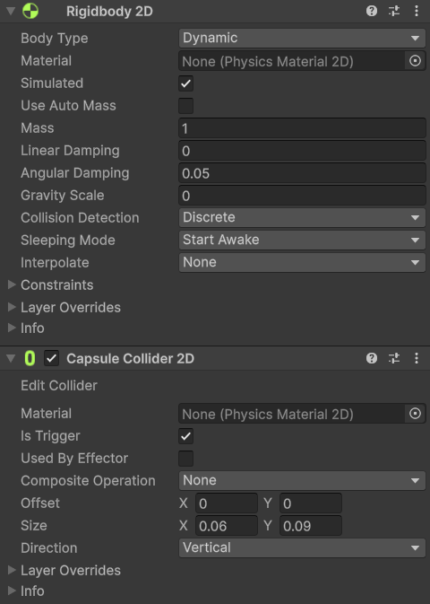
</p>

- `RigidBody 2D`: this component is crucial to handle the correct interaction with objects. Note that the `Gravity Scale` is set to zero, otherwise balistic will come into play.
- `Capsule Collider`: this is also crucial for the correct interaction with other objects. The `Is Trigger` checkbox must be ticked, this way the spell will be compenetrable, but will launch an event when interacting with specific objects.

<p align="center">
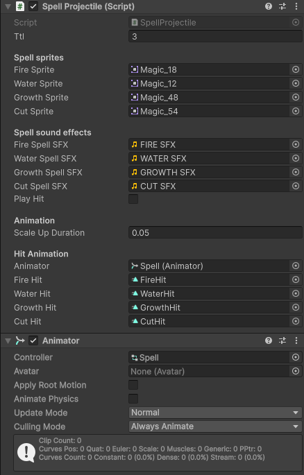
</p>

- `Spell Projectile:` this is a MonoBehaviour component which has various settings. `Ttl` indicates how much time (in seconds) must pass before the spell gets destroyed if it does not hit anything. The `Spell sprites` section requires references to the sprites of each kind of spell. Fallback solutions are implemented if these are missing. `Spell sound effects` contain the audio clips for the specific spells to be played from the `AudioManager`. `PlayHit` refers to whether or not play a hit sound effect. `Scale Up Duration` is used to signal in how much time the spell grows to its actual size. `Hit Animation` contains the animations for the four spells.
- `Animator`: contains the animation controller which animation will be changed based on the casted spell.

##### Spell casting

The casting of spells will be handled by a single script called `SpellCaster.cs`. This component must be attached to the player.

This component handles the casting of spells, from the pressing of the keys, up until the instantiation of the projectiles or interaction with an object.

Below is shown the component in the _Unity Inspector_.

<p align="center">
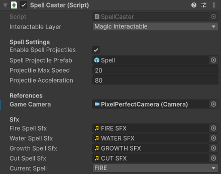
</p>

- `Interactable Layer`: this is the layer in which all objects that will interact with the spells must reside. A custom `Magic Interactable` layer has been added for this specific purpose.
- `Spell Settings`: it handles various settings: switching between the two spell implementation, asking for a reference for the spell prefab, fine tuning the spell projectile maximum speed and acceleration.
- `Sfx`: handles the various sound effects for the spells. It is a fallback for the spell prefab sfx.
- `Game Camera`: asks for a reference to the game camera in order for the correct functioning of the aiming and selection system.

##### Interactable objects

Interactable objects will implement the factory design pattern. An interface called `ISpellInteractable` has been created and must be included to all classes that want to have interactions with spells.

A sample prefab for these type of objects has been created. It can be found in the appropriate folder under the name `SpellInteractabeObject`.

This prefab includes a main object and a empty child object. This is used to handle the highlighting feature.

A similar structure can be implemented also for objects the player interacts without the use of spells.

Below can be found all the components essential for the correct functioning of spell interactable objects. More components can be added, but these are the essential ones.

<p align="center">
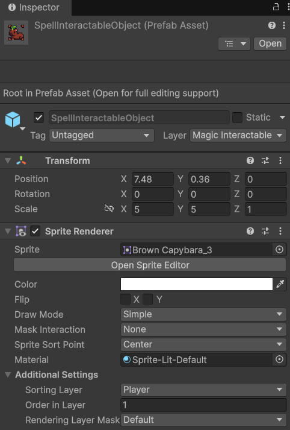
</p>

- `Layer`: the object must reside in the `Magic Interactable` layer. This is essential, since spells will only interact with objects in this layer.
- `Sprite Renderer`: this is used to show the sprite of the object.

<p align="center">
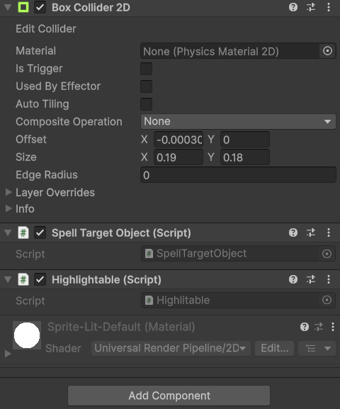
</p>

- `Collider 2D`: can be any type of collider, box is recommender for its low computational needs. `Is Trigger` must be left unchecked so the player cannot trepass the object.
- `Spell Target Object`: script that implements the various interactions that an object can have with the spells.
- `Highlitable`: script that handles the highlighting of the object while the player hovers it with the cursor.

In order for the object to be highlightable, the object prefab must have an empty child exactly named `Highlight`.

In the end, for the object which interact with spells, the highlighting was not used, but the implementation is still available for future uses or changes.

##### UML Diagram

<p align="center">
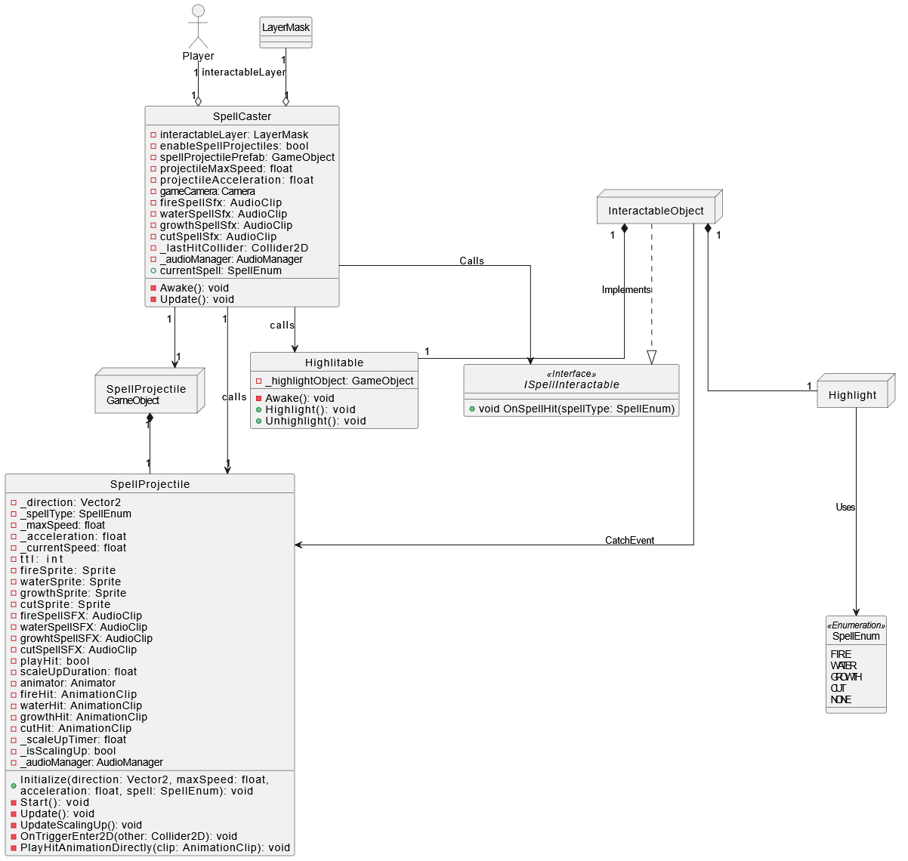
</p>

#### **Inventory System**

The inventory system is composed of 2 parts: the main inventory panel and the quick inventory panel.

The quick inventory panel represents the currently selected item from the inventory. It can be considered as a single slot with 2 buttons for switching selections, while the main inventory consists of 36 slots. Each slot stores one type of item and displays the item's icon along with its quantity (when the amount is greater than 1). The selected slot is highlighted in the main inventory. When the inventory is open, character movement is disabled.

##### Main Interfaces/Functionalities

- **Dropping Items**: Users can press `X` to drop items. Items are dropped in front of the character based on their facing direction (up, down, left, or right) and a configurable drop distance. Other programmers can adjust this distance in the Unity Inspector when selecting the character in the Hierarchy window. The implementation uses `PlayerItemController::DropItem(Collectable item)`. Since there's only one `PlayerItemController`, other components can access it through `FindObjectOfType` or `GameObject.FindGameObject` and call this function.

- **Collecting Items**: Characters can collect items of the Collectable class through collision detection. This functionality is handled by the `OnTriggerEnter2D(Collider2D collision)` method in the Collectable class. This method can be extended for farming mechanics - for example, by adding a condition to check if a Cut Spell is used on a collectible item.

- **Opening/Closing Inventory**: Press the `I` key to toggle the inventory panel. When the panel is active, users can also close it using the `ESC` key or the X button.

- **Switching Selection**: There are 2 ways to change inventory selection:

  1. Clicking the left or right buttons in the quick inventory panel or using `E` and `Q`
  2. Clicking directly on the desired slot in the main inventory

- **Collectable Objects**:
  The collectable objects refers to the objects that can be put into inventory. There 4 categories (`NONE`, `FOOD`, `SEED`, `INGREDIENTS`) and multiple different types (`APPLE`, `POTATO`, `MEAT`, etc). One item can have different categories, for example, there will be prefabs of potato in form of seed and in form of ingredient.
  To configure collectible items for the inventory, modify the corresponding prefabs by changing their sprites and types. Then, add new **prefabs under a file called Prefabs** (not the ones on the scene) to the "Collectable Items" list in the `ItemManager` script attached to the "Manager" GameObject under the "Inventory System" hierarchy.

<p align="center">

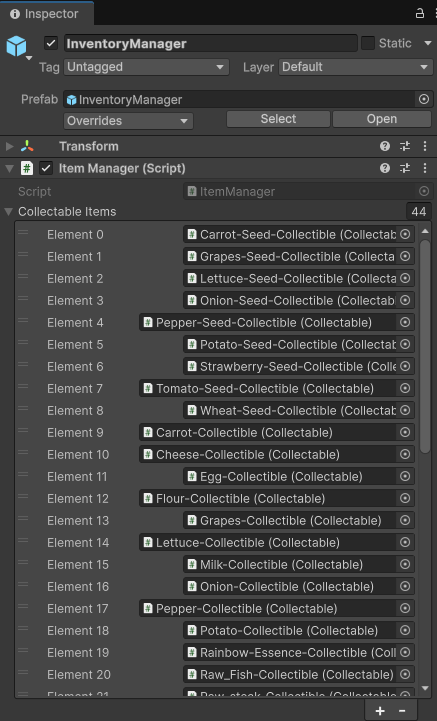
</p>

##### Item Manager

The `ItemManager` is responsible for generating a dictionary containing all collectable objects:

```csharp
Dictionary<string, Collectable>
```

The **key** is a string formatted as:

```
"{Category} - {Type}"
```

For example: `"SEED - POTATO"` or `"FOOD - COOKED_STEAK"`.

This system allows for fast lookup of collectable prefabs based on their type and category.

There are also two important **private lists** inside the `ItemManager` that control whether items from certain categories can be picked up or dropped:

- `List<CollectableCategory> NoCollisionCategory`  
  Prevents items in certain categories from being collected via collision.

- `List<CollectableCategory> NoDroppableCategory`  
  Prevents items in those categories from being dropped by the player.

##### UML Diagram

<p align="center">
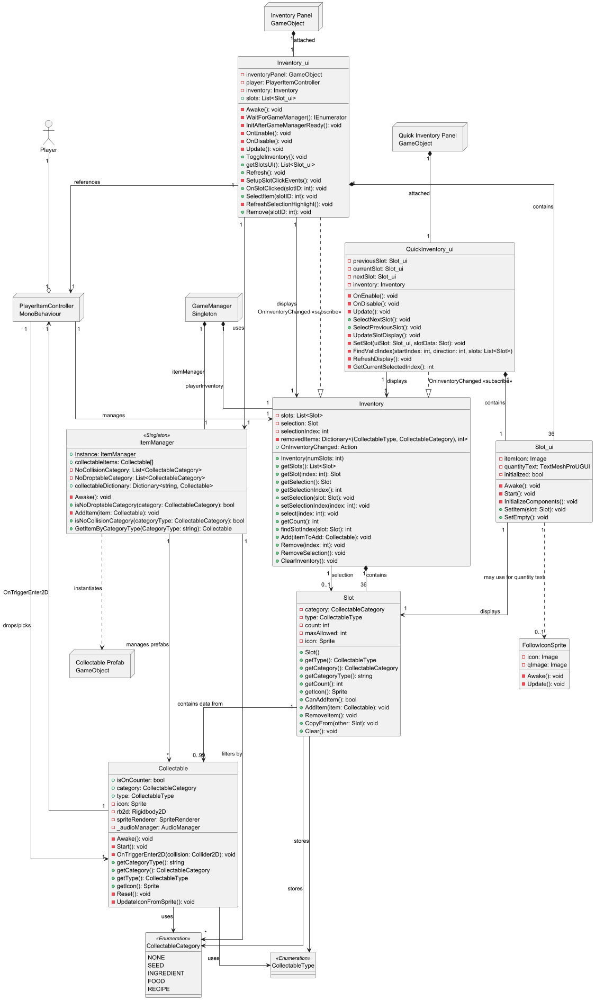
</p>

#### **Dialogue System**

The dialogue system is used to run welcome dialogues in each scene and to handle interactions with NPCs or environmental objects (such as doors).  
Our implementation is based on the plugin from [Wafflus](https://github.com/Wafflus/unity-dialogue-system), but we have **extended its functionality** to support calling custom functions directly from dialogue choices and **displaying custom character portraits**.

To open the dialogue editor window, go to **Window → DS → Dialogue Graph**.

<p align="center">
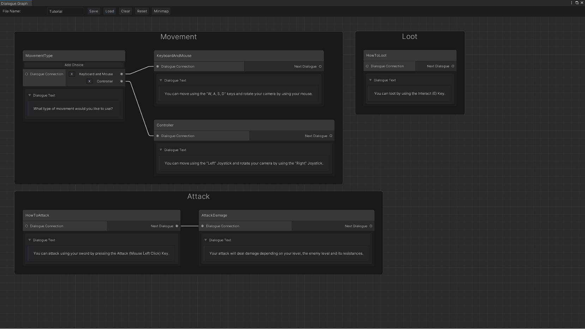

</p>

Before using this system, make sure the **DialogueSystem**, **Editor**, and **Editor Default Resources** folders are created under the **Assets** directory.

<p align="center">
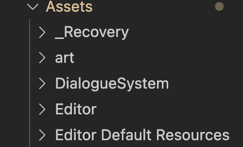
</p>

##### Creating Dialogues

To create dialogue content within the dialogue graph, right-click anywhere in the graph window and choose either a **Single Selection** or **Multiple Selection** node.  
Configure the dialogue text, selection options, and node connections to define the dialogue flow.

Click **Save** to store your work.

- The dialogue container will be saved as `DSDialogueContainerSO`
- Each dialogue node will be saved as `DSDialogueSO`  
  Saved files are located in:  
  **Assets/DialogueSystem/Dialogues/FarmToTavernTrigger**

To edit an existing dialogue, click **Load** and select the dialogue file.

##### Assigning Dialogues to NPCs

To assign a dialogue to an NPC or other object, attach the `NPCDialogueTrigger` script and a `Box Collider 2D` set to `Is Trigger`.  
When the player enters this collider area and interacts with the NPC, the assigned `DSDialogueContainerSO` will play starting from its initial `DSDialogueSO` node.

Each NPC can have a **custom portrait** displayed during dialogue by assigning a sprite to the **NPC Portrait** field in the `NPCDialogueTrigger` component. This portrait will be shown in the dialogue UI when the conversation begins. If no portrait is assigned, a default portrait based on the player character's current form (dragon or human) will be displayed.

##### Extended Feature: Calling Functions from Dialogue Choices

We have extended the original dialogue plugin to support **function calls from dialogue choice selections**.  
Each option can trigger custom functions through the **On Choice Events** panel:

- The first event slot corresponds to the first option.
- The second event slot corresponds to the second option, and so on.

This allows dialogues to directly influence gameplay logic.

<p align="center">

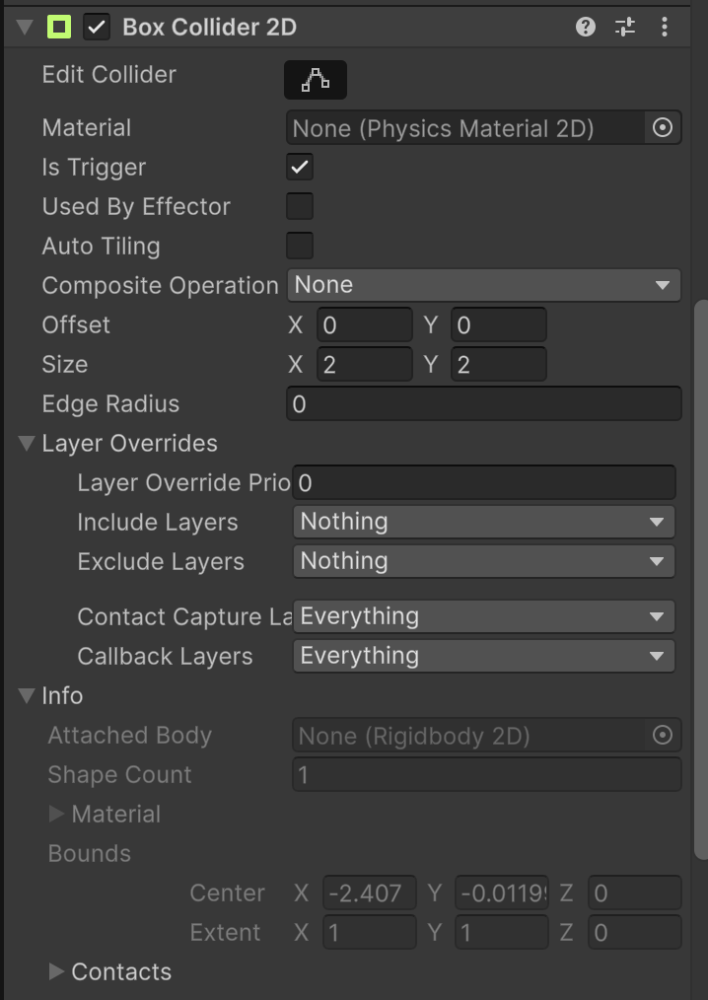
</p>

#### **Money System**

The money system allows the player spend money throughout the game. The player starts with a predefined amount of money,
which can be defined in the `PlayerStats.cs`. The current amount of money is displayed in the UI at all times.

<p align="center">
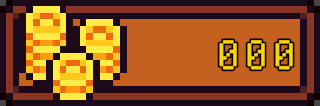
</p>

##### Technical Money Implementation

- **Player Stats**: The `PlayerStats` class manages the player's money. It provides methods to spend money and check if
  the player has enough money for a transaction. The starting amount of money can be set in the inspector.
- **Money Display**: The `MoneyDisplay` class is responsible for updating the money display in the UI. It listens for
changes in the player's money and updates the UI text accordingly.
<p align="center">
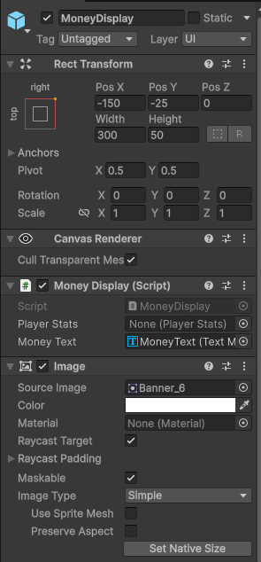
</p>

##### UML Diagram

<p align="center">
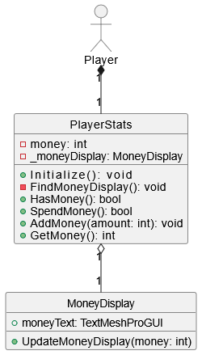
</p>

#### **Recipe Book**

The recipe book allows the player to have a quick lookup for the recipes he has unlocked, showing ingredients and how it should be cooked. It also allows the player to preview the icons of the recipes he has not unlocked yet.

The book can be accessed any time by pressing *B* and has a two page layout: the left page shows recipe icons and the right page shows detailed recipe information.

##### Main Interfaces and Functionalities

**Opening/Closing the Book**: The `B` button serves as a toggle for opening the book UI. For closing, the player can also use `ESC`.

**Left Page - Recipe Icons Grid**: The layout of the left page is of a six-columns grid. Each cell represents a recipe, which can be in three states:
* Locked (grayed out, non-interactive)
* Unlocked (colored, clickable)
* Selected: Shows a special "clicked" background sprite to indicate the currently viewed recipe

**Right Page - Recipe Details**: When a recipe icon is clicked, the right page displays comprehensive information about that recipe:
* Recipe Image: Large visual representation of the final dish
* Station Icon: Shows which cooking station is required (Cutting Board, Stove, Oven, Pot, or Keg)
* Ingredient Icons: Displays all required ingredients with quantity labels (e.g., "2x Potato")
* Spell Icons: Shows the sequence of spells that must be cast during cooking (Fire, Water, Growth, Cut)

**Dynamic Recipe Unlocking**: The book automatically updates when new recipes are unlocked during gameplay. This is achieved through an event-driven architecture where the `RecipeTracker` fires an `OnRecipeUnlocked` event that the book UI subscribes to. Icons transition from locked to unlocked state in real-time, providing immediate visual feedback to the player.

**Recipe Data Structure**: Recipes are implemented as ScriptableObjects, making them easy to create and configure in the Unity Editor. Each recipe contains the following information:
* `ingredientsNeeded`: List of `CollectableType` representing required ingredients
* `amountNeeded`: List of integers representing quantities (parallel array to ingredients)
* `orderTime`: Time limit in seconds for preparing this dish as an order
* `image`: Sprite shown in the book and order UI
* `money`: Gold reward for successfully completing an order of this dish
* `foodType`: The `CollectableType` that identifies the final cooked dish
* `formula`: A `CookingFormula` object containing the cooking process details
* `station`: Enum indicating which cooking station must be used (`StationType`: `CuttingBoard`, `Keg`, `Oven`, `Pot`, `Stove`)
* `spells`: List of `SpellType` enums representing the spell sequence (`Water`, `Fire`, `Growing`, `Cut`)

To configure recipes for the book system:
* Create a new Recipe ScriptableObject by right-clicking in the Unity Project window and selecting Create → Orders → Recipe
* Configure all fields including ingredients, amounts, cooking formula, visual assets, and rewards
* Add the recipe to the RecipeTracker's `allRecipes` list in the Inspector
* The recipe will appear in the book, starting in a locked state unless added to default recipes

<p align="center">
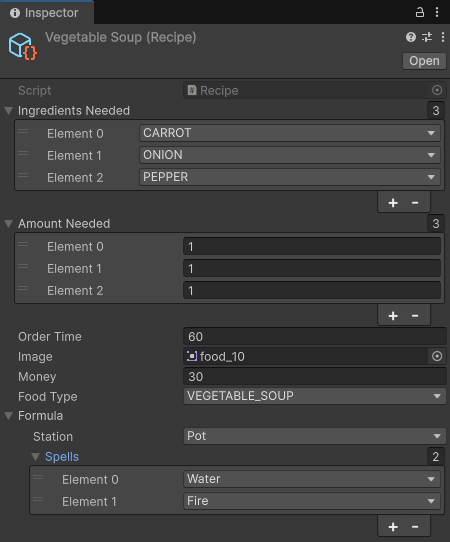
</p>

**Recipe Tracker System**: The `RecipeTracker` is a singleton MonoBehaviour that manages all recipes and their unlock states throughout the game. It persists across scene transitions using `DontDestroyOnLoad`, ensuring that recipe unlock progress is maintained.
The `RecipeTracker` unlocks a set of starter recipes when the game begins through the `UnlockDefaultRecipes()` method. Currently, these default recipes include:
* Baked Potato
* Salad
* Cooked Steak
* Wine
* Vegetable Soup

<p align="center">
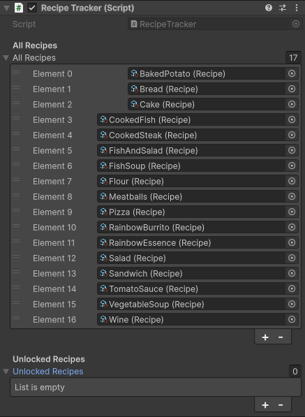
</p>

##### Component Architecture

**BookPanelUI**: it is the main component for the book interface. It manages both pages and handles the coordination between recipe selection and display. The component subscribes to `RecipeTracker.Instance.OnRecipeUnlocked` in its `Enable()` method and unsubscribs in `OnDisable()`, ensuring clean event management.

 <p align="center">
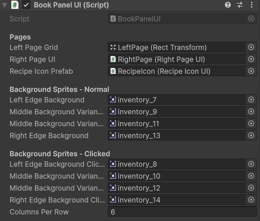
</p>

* `leftPageGrid`: Transform acting as parent for the recipe icon grid
* `rightPageUI`: Reference to the RightPageUI component
* `recipeIconPrefab`: Prefab used to instantiate recipe icons
* `Background sprites (normal state)`: leftEdgeBackground, middleBackgroundVariantA, middleBackgroundVariantB, rightEdgeBackground
* `Background sprites (clicked state)`: leftEdgeBackgroundClicked, middleBackgroundVariantAClicked, middleBackgroundVariantBClicked, rightEdgeBackgroundClicked
* `columnsPerRow`: Number of recipe icons per row (default: 6)

**RecipeIconUI Component**: The `RecipeIconUI` component represents an individual recipe icon in the left page grid. Each icon is instantiated from a prefab and configured by the BookPanelUI. It is designed to be reusable and works for both BookPanelUI and MenuManager.

<p align="center">
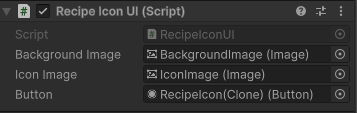
</p>

**CookingFormulaUI Component**: The `CookingFormulaUI` component is responsible for generating the visual representation of a recipe's cooking formula, including station, ingredients, and spell icons.

<p align="center">
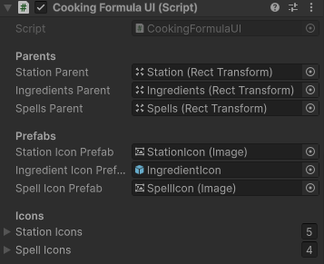
</p>

**RightPageUI Component**: The `RightPageUI` manages the display of recipe details on the right page of the book.

<p align="center">
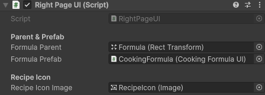
</p>

##### UML Diagram

<p align="center">
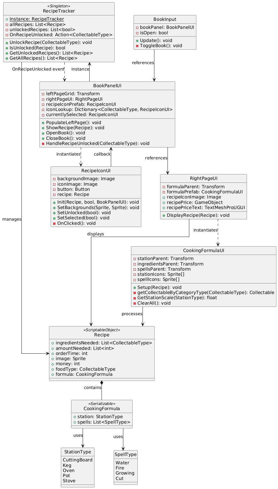
</p>

#### **Audio**

The audio system manages all sound in the game through a centralized AudioManager singleton. It is divided into three main categories: background music, sound effects (SFX), and ambient/environmental audio. The system supports dynamic music transitions based on scene changes, context-specific walking sounds, looping environmental effects for cooking equipment, and volume mixing across separate audio channels. Audio can be triggered by player actions (spell casting, item collection, movement), cooking interactions (boiling, cutting, oven, stove, keg), and UI interactions (purchasing items, inventory operations).

##### Main Interfaces and Functionalities

**Background Music Management**: The system automatically changes background music based on the current scene. Music transitions are handled through the `OnSceneLoaded` callback, which detects scene changes and plays the appropriate track. The implementation uses `AudioManager.Instance.PlayBackgroundMusic(AudioClip musicClip)` to ensure smooth transitions without music overlap:
* `FarmScene`: Plays outdoor farm background music
* `TavernScene`: Plays indoor tavern background music
* `BootScene`: No music (loading scene)
* Finale: Special finale music tracks with fade-out support

**Sound Effects (SFX) Triggering**: Sound effects are triggered through the AudioManager singleton. Other programmers can access it via `AudioManager.Instance.PlaySFX(AudioClip sfxClip)`. This method uses Unity's `PlayOneShot` functionality, allowing multiple sound effects to overlap without interrupting each other.

**Volume-Reduced SFX**: For sound effects that should be quieter (such as spell impact sounds), use `AudioManager.Instance.PlaySFXVolumeReduced(AudioClip sfxClip, float volumeScale)`. The volumeScale parameter ranges from 0.0 to 1.0, where 0.5 represents 50% of the original volume.

**Walking Sound System**: Walking sounds are context-aware and alternate between two footstep sounds to create a natural walking rhythm. The system automatically selects between indoor and outdoor footstep sounds based on the current scene:
* `TavernScene`: Uses `walkingInside` audio clips
* Other Scenes: Uses `walkingOutside` audio clips

The system alternates between two clips using a boolean flag (`_isFirst`) to create a left-foot/right-foot effect. Other systems can check if walking sounds are currently playing using `AudioManager.Instance.IsWalkingSoundPlaying()` and stop them with `AudioManager.Instance.StopWalkingSound()`.

**Environmental/Equipment Audio**:
The audio system includes dedicated `AudioSources` for looping environmental sounds related to cooking equipment. These sounds can be started and stopped independently:
* `PlayBoilingSound(bool stop = false)` - Looping boiling water sound
* `PlayStoveSound(bool stop = false)` - Looping stove cooking sound
* `PlayOvenSound(bool stop = false)` - Looping oven cooking sound
* `PlayKegSound(bool stop = false)` - Looping keg fermentation sound

Each method checks if the sound is already playing to prevent duplicate instances. Passing `stop = true` stops the respective sound loop.

**Volume Controls**:
The system provides separate volume controls for music and sound effects. Volume changes are applied to the following audio channels:

*Music Volume*: Affects only the background music source
```csharp
AudioManager.Instance.SetMusicVolume(float volume);
```
*SFX Volume*: Affects all sound effect sources including:
* General SFX source
* Walking sounds
* Boiling sounds
* Cutting sounds
* Stove sounds
* Oven sounds
* Keg sounds
```csharp
AudioManager.Instance.SetSFXVolume(float volume);
```
Volume values range from 0.0 (muted) to 1.0 (full volume). These settings are typically controlled through UI sliders in the settings menu (see `SettingsMenu.cs`).

##### Technical Implementation

**AudioManager Architecture**: The `AudioManager` follows the Singleton Pattern to ensure only one instance exists throughout the game. It persists across scene changes using Unity's `DontDestroyOnLoad` functionality.

**Audio Source Configuration**: The `AudioManager` uses multiple AudioSource components, each serving a specific purpose:

Audio Sources:
* backgroundMusicSource - Handles all background music with looping enabled
* sfxSource - General-purpose sound effects (one-shot sounds)
* walkingSource - Dedicated to footstep sounds
* boilingSource - Looping boiling water sound
* cuttingSource - Cutting/chopping sound effects
* stoveSource - Looping stove cooking sound
* ovenSource - Looping oven cooking sound
* kegSource - Looping keg fermentation sound

This separation allows for independent volume control and prevents audio conflicts. For example, multiple environmental sounds can play simultaneously (boiling + stove + oven) without interfering with each other.

**Audio Clip Organization**: All audio clips are organized in the Unity Inspector under serialized fields with header categories. Some of them are referenced in other scripts (spell casting and impact, drop sound, seed planting, purchase)

<p align="center">
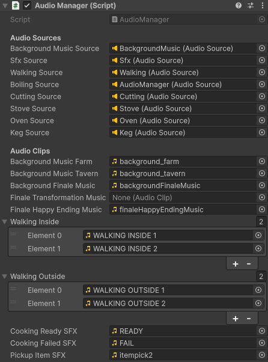
</p>

##### UML Diagram

<p align="center">
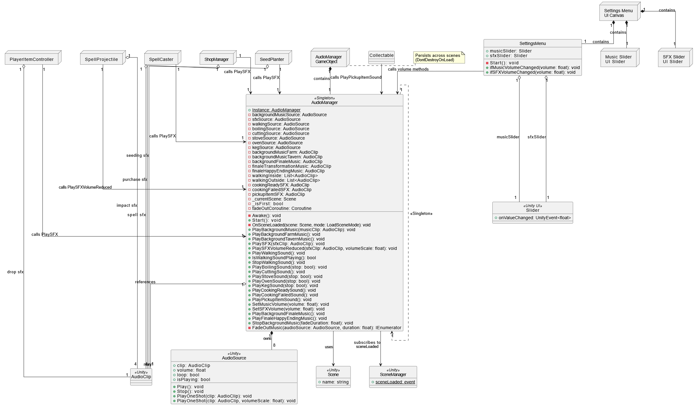
</p>

### **Farm Gameplay Elements**

#### **Shopping**

The shopping system allows the player to purchase seeds, ingredients, and recipes from NPCs through a GUI-based shop panel. The system is modular and can be attached to any NPC to make them a shopkeeper. When open, the game pauses (`Time.timeScale = 0`).

##### Main Interfaces and Functionalities

**Opening/Closing Shop**: Press `F` near a shopkeeper NPC to open the shop. When in range, the NPC displays a highlight indicator. Close the shop using `ESC` or the close button.

**Purchasing Items**: Click the item to purchase it. The system checks if the player has sufficient money via `PlayerStats::GetMoney()`. If affordable, regular items (seeds, ingredients) are added to inventory via `Inventory::Add()`, while recipes unlock via `RecipeTracker::UnlockRecipe()` and are removed from the shop permanently. Money is deducted through `PlayerStats::SpendMoney()`, and a purchase sound plays.

**Recipe Progression Gating**: Special recipes have unlock requirements:
* `RAINBOW_ESSENCE`: Requires all recipes except the rainbow ones to be unlocked
* `RAINBOW_BURRITO`: Requires all recipes plus `RAINBOW_ESSENCE` to be unlocked

Purchasing both final recipes triggers the game finale.

##### Key Components

**ShopItem (ScriptableObject)**: A wrapper class combining a Collectable with a price. Properties:
* `Collectable itemToGive` - The item to sell
* `int price` - Cost in gold

**ShopManager (MonoBehaviour)**: Handles purchasing logic and maintains shop inventory.

<p align="center">
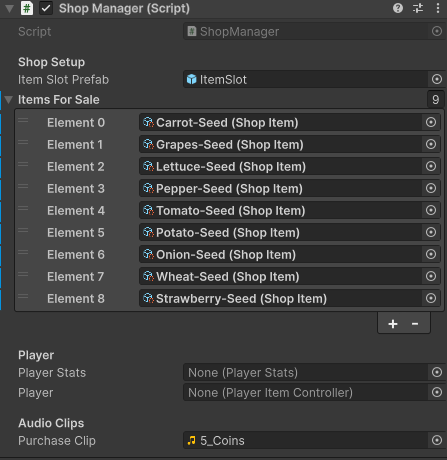
</p>

* *Shop Setup*: `GameObject itemSlotPrefab` - UI slot prefab reference, `List<ShopItem> itemsForSale` - Available items
* *Player References*: `PlayerStats playerStats` - Money system reference, `PlayerItemController player` - Player controller reference
* *Audio*: `AudioClip purchaseClip` - Purchase sound effect

**ShopPanelUI (MonoBehaviour)**: Manages UI display and item population.

<p align="center">

</p>

* `Button closeButton` - Close button reference
* `Transform itemContainer` - Parent for item slot instantiation

**SalesManNPC (MonoBehaviour)**: NPC controller that opens the shop on interaction.

<p align="center">

</p>

* *SalesManNPC*: `ShopManager shopManager` - Shop reference, `ShopPanelUI shopPanelUI` - UI reference (auto-found if not set)
* *NPCDialogueTrigger*: required to interact and have dialogues with the salesman
* *Requirements*: `Collider2D` with "Is Trigger" enabled, Child GameObject named "Highlight" for visual feedback, Player must have "Player" tag

##### Configuration

To set up a shop:

* Create ShopItem Assets:
  * Right-click → Create → Shop/Item
  * Assign Collectable prefab and set price

* Configure ShopManager:
  * Add ShopManager component to GameObject
  * Assign ItemSlot prefab
  * Add ShopItem assets to "Items For Sale" list
  * Assign PlayerStats and purchase sound

* Setup Shopkeeper NPC:
  * Add SalesManNPC component to NPC
  * Add Collider2D with "Is Trigger" enabled
  * Create "Highlight" child GameObject with sprite
  * Assign ShopManager reference

##### UML Diagram

<p align="center">

</p>

#### **Farming**

The farming and planting system enables players to cultivate crops through a cycle of planting, spell-based care, growth, and harvesting. The system is designed to be scalable, supporting multiple seed types.

##### System Overview

The farming system is composed of 4 main phases:
- **Planting** - Place seeds from inventory onto soil tiles
- **Care** - Apply required spells (Water and Growth) to crops
- **Growth** - Seeds advance through visual stages each day if requirements are met
- **Harvesting** - Use Cut spell on fully grown crops to collect items

The system integrates with the Inventory System (for seed selection and item drops) and the Spell System (for crop interactions).

##### Main Interfaces and Functionalities

**Planting Seeds**: Players plant seeds by approaching soil tiles with a seed selected in their inventory. The system automatically highlights the closest valid tile within range. Press the Interaction button to plant. Only one seed can occupy each soil tile. The planting distance can be configured in the Unity Inspector on the player's `SeedPlanter` component.

**Applying Spells to Crops**: Seeds require specific spells each day to grow. The standard requirement is one Water spell and one Growth spell. When a seed receives a required spell, it tracks the application and displays visual feedback (water darkens soil, growth adds green glow). Once all required spells are applied, the seed is marked as "ready to grow" for the next day cycle.

**Growth Progression**: At the start of each new day, seeds that received all required spells advance to the next growth stage. Seeds that didn't meet requirements remain at their current stage. Visual sprites update automatically to reflect the growth stage. Spell tracking resets daily.

**Harvesting Crops**: When a seed reaches its final growth stage, use the Cut spell to harvest it. The configured drop object (collectible prefab) spawns at the plant location, ready for pickup. Using wrong spells (like Fire spell) destroys the crop without dropping items.

Seeds are Unity Prefabs with the Seed component attached. Each seed must be configured with the following serialized fields:

<p align="center">
</img>
</img>
</p>

- `Growth Days (int)`: Number of days required for full maturity (default: 1)
- `Growth Sprites (List<Sprite>)`: Visual progression sprites. Must contain exactly (growthDays + 1) sprites, starting from the initial planted stage to fully mature
- `Drop Object (GameObject)`: Reference to the Collectable prefab dropped when harvested
- `Spells Needed (List<SpellEnum>)`: Required spells for daily growth (standard: `WATER` and `GROWTH`)
- `Sprite Renderer`: Displays current growth stage sprite. Set initial sprite to first growth stage
- `Collider 2D`: Enables spell interaction. Must reside in "Magic Interactable" layer or farming-specific layers
- `Child GameObject named "GrowthBackground"`: Provides visual effect when Growth spell is applied. Must be exactly named "GrowthBackground"

To create a new seed type:
1. Duplicate an existing seed prefab
2. Configure growth days and provide corresponding growth sprites
3. Set the drop object reference to the desired collectible
4. Modify spells needed if different from standard
5. Add the new prefab to the FarmingManager's Seeds list

##### Farming Manager

The FarmingManager is a singleton `DontDestroyOnLoad` component that maintains persistent state of all farming operations across scenes.

<p align="center">
</img>
</p>

- `Seeds (List<GameObject>)`: Master list of all plantable seed prefabs.  Every new seed type must be added to this list, otherwise players cannot plant it.

The FarmingManager handles:
- Tracking all planted seeds with position, type, growth stage, and readiness state
- Seed persistence across scene transitions (seeds remain when traveling to market/restaurant)
- Daily growth cycle processing via `EndOfFarmingDay()` function
- Soil tile occupancy validation

The manager uses an internal persistence system that stores seed data even when the farm scene is not loaded, ensuring crops continue to grow properly.

##### Seed Planter Component

The SeedPlanter script is attached to the player character and handles planting interactions.

<p align="center">
</img>
</p>

- `Maximum Planting Distance (float)`: Maximum distance from player to tile center for valid planting (default: 1.5 units)
- `Game Camera (Camera)`: Reference to the main camera
- `Seeding Clip (AudioClip)`: Sound effect played when planting

The following GameObjects must exist in the scene for proper functionality:
- *FarmingHighlight*: Visual sprite overlay showing valid planting tile
- *SoilTileMap*: Tilemap defining all plantable soil areas (must have TilemapCollider2D)
- *FarmingManager*: GameObject with FarmingManager script

The planter continuously searches for the closest valid tile within range when a seed is selected in inventory. It updates the highlight position and listens for the Interaction button press to execute planting.

##### Seed Growth and Spell Interactions

Seeds implement the `ISpellInteractable` interface to respond to spell projectiles. The Seed class tracks which spells have been applied each day through the `OnSpellHit(SpellEnum spellType)` method.

Spell Interaction Flow:
1. Spell projectile hits seed collider
2. `OnSpellHit()` checks if spell is in the `spellsNeeded` list
3. If valid, spell is added to daily tracking list `_spellsHit`
4. Visual feedback is applied (water darkens soil, growth shows green glow)
5. Collider layers are adjusted to prevent duplicate spell application
6. `IsReadyToGrow()` returns true when all required spells are received

At the end of each day, `FarmingManager.EndOfFarmingDay()` is called:
1. Iterates through all planted seeds
2. Checks `IsReadyToGrow()` status for each seed
3. Calls `IncreaseGrowthStage()` on ready seeds, updating sprite and stage counter
4. Calls `ResetSpellHit()` to clear daily tracking for the next day
5. Resets soil tile colors and visual effects

Harvesting: When a seed is at its final growth stage (`_growthStage == growthDays`) and receives the Cut spell:
1. The `Drop()` method instantiates the configured drop object at the plant position
2. Seed is removed from FarmingManager tracking via `DestroySeedAtPos()`
3. Seed GameObject is destroyed, freeing the soil tile

Using incorrect spells on plants (Fire, etc.) destroys them without dropping items, except Cut on fully grown crops.

Seeds implement `ISpellInteractable` from the spell infrastructure and must reside on "Magic Interactable" or farming-specific layers. Layer exclusion prevents duplicate spell application per day:
* After water: excludes "Farming Magic Interactable WATER"
* After growth: excludes "Farming Magic Interactable GROWTH"
* When ready: excludes both plus "Magic Interactable"

##### UML Diagram

<p align="center">

</p>

### **Tavern Gameplay elements**

#### **Cooking and Cooking Stations**

The cooking system enables players to prepare food items by combining ingredients at specialized cooking stations. Each station type supports different recipes and requires specific spell sequences to operate. The system is designed to be scalable, allowing easy addition of new stations and recipes.

##### System Overview

The cooking workflow consists of 4 main phases:

* Ingredient Placement - Add ingredients from inventory to cooking stations
* Spell Application - Use required spells to activate and operate the station
* Cooking Process - Progress bar advances until completion threshold is reached
* Collection - Pick up finished food items from the station output slot

The system integrates with the Inventory System (for ingredient management and food collection) and the Spell System (for station activation).

##### Main Interfaces and Functionalities

**Adding Ingredients to Stations**: Players add ingredients by approaching a cooking station within interaction range and pressing the `F` button. The system checks if the selected inventory item is accepted by that station type. Only ingredients in the `INGREDIENT` or `FOOD` category can be added. Stations reject ingredients when already cooking or when output is ready for collection.

**Applying Spells to Stations**: Each cooking station requires specific spells to operate. When a valid spell sequence is applied, the cooking bar becomes visible and starts filling. Invalid spells or wrong spell orders have no effect. The station tracks spell history to validate sequences. Here are the correct sequences for the various stations:
* **Boiling Station**: Water Spell to fill the pot, Fire Spell to cook
* **Stove Station**: Fire Spell to cook
* **Oven Station**: Fire Spell to start cooking, Water Spell to stop the oven before burning the food
* **Cutting Board**: Cut Spell to cut the food
* **Keg Station**: Water Spell to fill the keg, Growth Spell to cook

**Cooking Progress**: The cooking bar advances based on two modes:
- *Continuous Mode*: Bar fills gradually while the correct spell is being applied
- *Discrete Mode*: Bar advances in fixed increments with each valid spell cast

When the bar reaches the done threshold, the system checks the ingredients against available recipes. If a valid recipe is found, the output food item is created. If no recipe matches, the ingredients are wasted and the station resets.
Care that this does not direcly apply to the *Oven Station*, since reaching the done threshold does not automatically create the output food. The player needs to stop the cooking process at the right time to do so.

**Collecting Cooked Food**: When a station enters the `DONE` state, the output slot contains the finished food item. The player automatically collects it when within range, adding it to inventory. Collection resets the station to `RESTING` state, ready for new ingredients.

**Retrieving Ingredients**: Players can press the Retrieve button (default: `R`) to take back ingredients from a station before cooking ends. This returns all ingredients to the player's inventory and resets the station. Retrieval is disabled when food is ready for collection.


##### Player-Side Interactions

The PlayerCook component is attached to the player character and manages all cooking station interactions.

<p align="center">
</img>
</p>

- *Interaction Distance (float)*: Maximum distance from player to station center for interaction (default: 2 units)
- *Cooking Highlight Prefab (GameObject)*: Reference to the highlight visual that appears when near a station

The component continuously searches for the closest cooking station within range. When found, it activates the highlight at the station's position and enables interaction buttons. Moving away from the station automatically disables the highlight.

##### Abstract Cooking Station

All cooking stations inherit from `AbstractCookingStation`, an abstract class that implements the Template Pattern. This provides a common framework while allowing stations to override specific behaviors.

**Ingredient Settings**:
- `acceptedIngredients (List<CollectableType>)`: Ingredient types this station can accept
- `CookingSlots (ArrayList)`: Currently placed ingredients awaiting cooking
- `CookingRecipes (List<Recipe>)`: Valid recipes for this station (serializable list)
- `OutputSlot (CollectableType)`: The finished food item ready for collection

**Cooking Bar Settings**:
- `doneThreshold (int)`: Progress value required to complete cooking
- `isDiscrete (bool)`: If true, bar advances in steps; if false, advances continuously
- `CookingBarValue (float)`: Current progress value
- `cookingVelocity (float)`: Speed at which bar increases when cooking is active
- `cookingDeceleration (float)`: Rate at which bar decreases when spell stops (only for boiling station and stove)
- `minNegativeVelocity (float)`: Minimum (negative) speed for bar decrease

**Cooking Station Settings**:
- `CurrentState (CookingStationStateEnum)`: Current operational state (`RESTING`, `READY`, `COOKING`, `DONE`)
- `spellsNeededToWork (List<SpellEnum>)`: Spells required to operate this station
- `_spellHistory (ArrayList)`: Sequence of spells cast on the station this session

**UI Settings**:
- `cookingBarSlider (Slider)`: UI slider displaying cooking progress
- `itemCloud (GameObject)`: Container for ingredient/food icon display
- `itemSpriteImage (Image)`: Displays the current item sprite
- `itemQuantityText (TextMeshProUGUI)`: Shows ingredient quantity when multiple present
- `spriteRotationSpeed (float)`: Rotation speed for cycling through multiple ingredient icons

**Key Virtual Methods** (can be overridden by specific stations):
- `TryToAddIngredient(player)`: Attempts to add ingredient from player inventory
- `OnSpellHit(spellType)`: Handles spell interaction logic
- `UpdateCookingBar()` / `UpdateCookingBarDiscrete()`: Updates progress bar based on mode
- `CookingReady()`: Called when cooking completes; checks recipes and sets output
- `ResetStation()`: Returns station to initial RESTING state
- `CheckRecipes(ingredients)`: Matches ingredient list against valid recipes
- `UpdateVisualFeedback()`: Updates UI to show current ingredients or output
- `TryRetrieveIngredients(player)`: Returns ingredients to player before cooking

The abstract class implements `ISpellInteractable` interface, allowing stations to respond to spell projectiles like other spell-interactive objects.

##### Cooking Station States

`CookingStationStateEnum` defines the operational states:

- `RESTING`: Station is empty with no ingredients or output. Initial state
- `READY`: Ingredients have been added and station awaits spell activation
- `COOKING`: Cooking process is active; cooking bar is visible and updating
- `DONE`: Food is ready for collection; output slot contains finished item
- `NONE`: Used only for initialization and default operations

State transitions:
1. `RESTING` → `READY`: When first ingredient is added
2. `READY` → `COOKING`: When correct spell sequence is applied
3. `COOKING` → `DONE`: When cooking bar reaches done threshold
4. `DONE` → `RESTING`: When player collects the output
5. Any state → `RESTING`: When player retrieves ingredients or station resets

##### Example: Boiling Station

The`BoilingStation` is a concrete implementation of `AbstractCookingStation`. It demonstrates the standard cooking station structure. Other cooking stations differ from this one, but the main components persist through them.

<p align="center">
</img>
</p>

- *Collider 2D*: Is Trigger must be OFF so player cannot pass through. Required for spell collision
- *RigidBody 2D*: Body Type set to Static. Essential for proper spell interaction
- *Sprite Renderer*: Displays station visual state (resting, cooking, done sprites)

<p align="center">
</img>
</p>

- `Accepted Ingredients`: `CARROT`, `ONION`, `PEPPER`, `COOKED_FISH`
- `Cooking Recipes`: List containing the recipes that can be cooked in this stations
- `Done Threshold`: Progress value to complete cooking
- `Spells Needed to Work`: `WATER`, `FIRE`
- `UI Settings`: references to various components needed for the station's visual feedback.

<p align="center">
</img>
</img>
</p>

- *Canvas*: Unity Canvas component containing all UI elements
- *CookingBar*: Child object with Slider component for progress visualization
- *ItemCloud*: Container showing current ingredient icons or output food sprite

The methods that were ovverriden are:
- `OnSpellHit()`: Validates WATER spell first, then FIRE spell to start cooking
- `UpdateCookingBar()`: Custom logic for continuous cooking bar progression
- `CookingReady()`: Checks ingredients against recipes and sets output or trash
- `ResetStation()`: Resets sprite to resting state when station clears

##### Creating New Cooking Stations

To add a new cooking station type:

1. Create a new class extending `AbstractCookingStation`
2. Configure accepted ingredients list in the Inspector
3. Create Recipe ScriptableObjects and add to CookingRecipes list
4. Override `OnSpellHit()` to define required spell sequence
5. Optionally override `UpdateCookingBar()` for custom cooking behavior
6. Optionally override `CookingReady()` for special completion logic
7. Add required Unity components: Collider2D, RigidBody2D, Sprite Renderer
8. Set up Canvas child with CookingBar and ItemCloud UI elements
9. Configure visual sprites for different states (resting, cooking, done)

##### UML Diagram

<p align="center">

</p>

#### **Orders**

This section describes how orders and recipes work behind the scenes. The system is divided into the following subsections:

- Order Management
- Customer Queue System
- Recipe Handling
- Order User Interface

##### Order Management

The order management system is handled by the `OrderManager` component with the `OrderManager.cs` script.

<p align="center">

</p>

- *Recipes*: List of recipes available for order generation in full game mode, will be modified by the recipe menu.
- *Order Prefab*: UI prefab instantiated for each new order
- *Order Parent*: Canvas transform where order UI elements are spawned
- *Is Prototype*: Boolean enabling prototype mode for testing with limited recipes
- *Prototype Recipes*: Limited recipe set used when prototype mode is active
- *Initial Orders*: Number of orders spawned at gameplay start
- *Time Between Orders*: Base time interval (seconds) between order generations
- *Delta Time Between Orders*: Random variation (±delta) applied to order timing
- *Max Orders Present On Screen*: Maximum concurrent active orders
- *Total Num Of Orders*: Total orders to generate before day end
- *Customer Queue*: Reference to `CustomerQueueManager` handling customer positions
- *Customer Prefabs*: Pool of customer variants with unique portraits
- *Customer Spawn Point*: Position where customers are instantiated
- *Counter Point*: Target position for customers at ordering station
- *Exit Point*: Destination for customers leaving after completion/failure
- *Counter Slot*: Interactable slot where players place completed dishes

The order system works as follows:

**Order Generation**: When `StartOrderGeneration()` is called, the system begins a coroutine that:

1. Validates available recipes against player inventory
2. Spawns `initialOrders` at gameplay start
3. Continues generating orders at intervals (`timeBetweenOrders` ± `deltaTimeBetweenOrders`)
4. Stops when `totalNumOfOrders` is reached or no valid recipes remain

**Recipe Selection**: The system uses intelligent validation:

- **Prototype mode**: Selects only from `prototypeRecipes` list
- **Full mode**: Checks player inventory for available ingredients using recursive validation (`CanCookWithIngredients()`) that considers sub-recipes for missing ingredients

**Order Fulfillment**: When a player places an item on the counter slot, `TryToFulfillOrder(Order order, Collectable item)` is called:

- Checks if item's `CollectableType` matches order's `foodType`
- On match: Awards money, increments `successfulOrders`, removes order, spawns new order
- On mismatch: Item remains in inventory, order unchanged

**Order Expiration**: When timer reaches zero, `DeleteOrder(Order order)` is triggered:

- Increments `failedOrders` counter
- Removes order from active list
- Customer leaves disappointed
- New order generated to replace failed one

The system tracks statistics (`successfulOrders`, `failedOrders`, `moneyGained`) which integrate with `EndOfDayManager` to show the results of the shift at the end of the day.

##### Customer Queue System

Each customer is an autonomous agent linked to their order. When an order is generated:

1. Random customer prefab is instantiated at `customerSpawnPoint`
2. Customer component is initialized with references to counter, exit, and linked order
3. Customer is added to queue via `CustomerQueueManager.AddCustomerToQueue()`
4. Customer moves through queue positions until reaching the counter
5. Customer subscribes to order's `OnOrderExpired` event

Customer States:

- `QUEUING`: Moving to/waiting at queue position
- `ORDERING`: At counter with active order
- `LEAVING_SATISFIED`: Exiting after successful order fulfillment
- `LEAVING_DISSATISFIED`: Exiting after order failure/timeout

Each customer has a unique `customerPortraitImage` sprite displayed in the order UI. A cloud above the customer shows the requested dish sprite.

**CustomerQueueManager**: handles:

- Queue position assignment and updates
- Advancing queue when counter becomes available
- Preventing spatial overlap between queued customers

##### Order User Interface

The order UI displays active customer requests at the top of the screen.

<p align="center">

</p>

The `OrderTimer()` coroutine:

1. Decrements `_remainingTime` every second
2. Updates timer bar visual scale
3. When timer reaches zero, invokes `OnOrderExpired` event
4. Calls `OrderManager.DeleteOrder(this)` for cleanup

**UI Layout**: Orders are positioned horizontally at `anchoredPosition.x = orderIndex * 300`. When orders are removed, `RefreshOrderPositions()` repositions remaining orders smoothly.

**Tutorial Integration**: Orders created via `CreateTutorialOrder(Recipe recipe)` never expire when `SetTutorialMode(true)` is called, allowing players to learn mechanics without time pressure.

##### UML Diagram

<p align="center">

</p>

#### **End Of Day Management**

The `EndOfDayManager` component handles the transition from the cooking phase (tavern evening) to the next phase (farm morning). It monitors order completion status and triggers the day-end sequence when appropriate conditions are met.

##### Configuration

<p align="center">

</p>

- *Order Manager*: Reference to the `OrderManager` to query statistics and completion status
- *End Of Day UI*: Reference to the UI component that displays day statistics
- *Transition Duration*: Time in seconds for the fade transition effect (default: 1.5s)
- *Delay Before Transition*: Delay in seconds before showing the end-of-day screen (default: 1s)


##### Day End Triggers

The system continuously monitors for day-end conditions via `CheckForDayEnd()`:

1. **All Orders Processed**: When `OrderManager.AreAllOrdersProcessed()` returns true (all `totalNumOfOrders` have been completed or failed)
2. **No Valid Recipes**: When `OrderManager.HasNoValidRecipes()` returns true (player has no ingredients left to cook any available recipe)

**Important**: The day will NOT end during the cooking tutorial, even if conditions are met. This prevents premature day-end while players are learning.

When `TriggerEndOfDay()` is called, the following sequence executes:

1. **Delay**: Waits `delayBeforeTransition` seconds to allow final animations/sounds to complete
2. **Statistics Collection**: Gathers data from OrderManager:
   - `ordersCompleted`: Number of successfully fulfilled orders
   - `ordersFailed`: Number of expired/failed orders
   - `moneyEarned`: Total currency earned this day
   - `customersServed`: Total customers processed (completed + failed)
3. **Event Trigger**: Invokes `OnDayEnded` UnityEvent for external systems to subscribe
4. **UI Display**: Shows `EndOfDayUI` with collected statistics and transition effect

##### Transition to Farm

When the player confirms the end-of-day screen, `EndDayAndGoToFarm()` is called:

1. **Inventory Cleanup**:
   - Restores filtered items (items temporarily hidden during cooking)
   - Removes burnt and trash items from inventory
2. **Day Increment**: Calls `GameManager.IncrementDay()` to advance to next day
3. **Time Reset**: Resets `Time.timeScale` to 1.0
4. **UI Cleanup**: Destroys the EndOfDayUI GameObject
5. **Scene Load**: Uses SceneController to load the farm scene

##### Integration with Order System

The OrderManager communicates with EndOfDayManager at key points:
- When no valid recipes are found during order generation, it calls `EndOfDayManager.Instance.CheckForDayEnd()`
- The EndOfDayManager queries OrderManager statistics when building the end-of-day summary
- Tutorial system can prevent day-end by keeping the cooking tutorial active

**Singleton Pattern**: EndOfDayManager uses the singleton pattern to provide global access via `EndOfDayManager.Instance`, ensuring only one instance exists per scene and allowing any system to trigger or query day-end status.


#### **Recipe Menu**

The Recipe Menu system allows players to select which dishes can be ordered during a tavern shift. The menu appears at the start of each shift, displaying unlocked recipes that can be cooked with available ingredients. Upon confirmation, only selected recipes are used for customer orders, and the inventory is filtered to contain only relevant ingredients.

##### System Overview

The menu presents a book-style interface with two pages:
- *Left Page*: Grid of recipe icons (6 per row) showing unlocked, cookable recipes
- *Right Page*: Detailed recipe view displaying the cooking formula (station, ingredients, and spell sequence)

When active, the game pauses (Time.timeScale = 0) until the player confirms their selection. Players can select multiple recipes, and the system validates ingredient availability through recursive checking of sub-recipes.

##### Main Interfaces/Functionalities

**Recipe Selection**: Players click icons to select/deselect recipes. Multiple selections are supported. Clicking a recipe displays its details on the right page. The system tracks selections using a HashSet for efficient lookup. Grayed-out recipes cannot be selected.

**Recipe Details Display**: When a recipe is selected, the right page shows:
- Recipe icon (large sprite of finished dish)
- Cooking station icon
- Ingredient icons with quantity labels (e.g., "2x")
- Spell icons in required sequence

The RightPageUI and `CookingFormulaUI` components dynamically instantiate these visual elements based on the Recipe's CookingFormula.

**Select All / Deselect All**: Utility buttons allow quick selection management. Select All automatically selects all cookable recipes (excluding grayed-out ones). Deselect All clears all selections and the right page display.

**Confirming Selection**: When confirmed:
1. Selected recipes are transferred to OrderManager's recipe list via reflection
2. `OrderManager.StartOrderGeneration()` begins spawning customer orders
3. Inventory is filtered via `FilterInventoryForRecipes()` to remove irrelevant items
4. Menu closes and game time resumes (`Time.timeScale = 1`)

If no recipes are selected, the system triggers the end-of-day sequence.

##### Recipe Availability Logic

The system determines cookability through recursive ingredient checking:

**Direct Ingredients**: First checks if ingredients exist in inventory (`INGREDIENT` category).

**Sub-Recipes**: If an ingredient is missing but is itself a craftable food with an unlocked recipe, the system recursively validates if that sub-recipe's ingredients are available.

Example: To cook Bread, Flour is required:
- Check if Flour exists in inventory (`FOOD` category)
- If not, check if Flour recipe is unlocked
- Recursively check if the ingredients for Flour are available (wheat)
- If all sub-ingredients are available, mark Bread as cookable

This logic is implemented in `MenuManager.CanCookWithIngredients()` using a working inventory dictionary that simulates ingredient consumption during validation.

##### Inventory Filtering

After confirmation, `FilterInventoryForRecipes()`:
1. Identifies all required ingredients for selected recipes (including sub-recipe ingredients recursively)
2. Stores removed items in a dictionary for potential restoration
3. Clears the entire inventory
4. Re-adds only required ingredients and quantities

Food items matching selected recipes are retained (e.g., pre-cooked dishes that fulfill recipe requirements).

##### Configuration

**MenuManager** Component:

<p align="center">

</p>

- `leftPageGrid (Transform)`: Parent transform for recipe icon grid
- `rightPageUI (RightPageUI)`: Reference to right page display
- `recipeIconPrefab (RecipeIconUI)`: Prefab for each recipe icon
- Background sprites (normal and clicked variants): Left edge, middle variants A/B, right edge
- `columnsPerRow (int)`: Recipe icons per row (default: 6)

**RightPageUI** Component:

<p align="center">

</p>

- `formulaParent (Transform)`: Container for formula UI elements
- `formulaPrefab (CookingFormulaUI)`: Recipe formula display prefab
- `recipeIconImage (Image)`: UI Image for recipe sprite

**CookingFormulaUI** Component:

<p align="center">

</p>

- `stationParent, ingredientsParent, spellsParent (Transform)`: Containers for respective icons
- `stationIconPrefab, ingredientIconPrefab, spellIconPrefab`: Icon prefabs
- `stationIcons (Sprite[])`: Array indexed by StationType enum
- `spellIcons (Sprite[])`: Array indexed by SpellType enum

##### UML Diagram

<p align="center">

</p>

### **Progression Gameplay Elements**

#### **Initial Cutscene**

The initial cutscene serves as the game's narrative introduction, playing automatically on first launch before the farming tutorial. It presents the backstory through a pre-rendered video sequence, establishing the game's premise and Azzy's cursed state.

##### Trigger Logic

**Boot Flow:** The `BootsceneController` determines scene routing based on tutorial completion state:

```csharp
public void StartGame()
{
    if (PlayerPrefs.GetInt("FarmTutorialDone", 0) == 1)
    {
        // Tutorial completed → load farm directly
        SceneFadeManager.Instance.FadeToScene("FarmScene");
    }
    else
    {
        // First playthrough → show cutscene
        SceneFadeManager.Instance.FadeToScene("CutScene");
    }
}
```

**Scene:** CutScene  
**Prerequisites:** None (plays on first game launch)  
**Skip Condition:** `FarmTutorialDone == 1`

##### Architecture

**Timer-Based Transition:** The `CutsceneController` manages automatic scene progression after video playback:

```csharp
public class CutsceneController : MonoBehaviour
{
    [SerializeField] private int secondsDelay = 55;
    [SerializeField] private string targetScene = "FarmScene";
    
    private Coroutine _timerCoroutine;
}
```

**Automatic Progression:**

```csharp
private IEnumerator TimerAndLoad(int seconds, string sceneName)
{
    yield return new WaitForSeconds(seconds);
    
    if (SceneFadeManager.Instance != null)
        SceneFadeManager.Instance.FadeToScene(sceneName);
    else
        SceneManager.LoadScene(sceneName, LoadSceneMode.Single);
}
```

Coroutine starts in `Start()`, waits for `secondsDelay`, then transitions to `targetScene` with fade effect.

##### Scene Transition Flow

| Step | Component | Action |
|------|-----------|--------|
| 1 | BootsceneController | Checks `FarmTutorialDone` PlayerPrefs |
| 2 | SceneFadeManager | Fades to "CutScene" if tutorial not done |
| 3 | CutsceneController | Starts 55-second timer coroutine |
| 4 | Video Player | Plays cutscene video (external asset) |
| 5 | CutsceneController | Timer completes, initiates fade |
| 6 | SceneFadeManager | Fades to "FarmScene" |
| 7 | FarmTutorial | Automatically activates (see Tutorial System) |

##### SerializeField Configuration

<p align="center">

</p>

- `secondsDelay: int` - Duration before auto-transition (default: 55)
- `targetScene: string` - Scene to load after cutscene (default: "FarmScene")

**Note:** The actual video playback is handled by Unity's Video Player component attached to the scene's Canvas. The `CutsceneController` only manages timing and scene transition.

##### Integration with Tutorial System

The cutscene system integrates seamlessly with the tutorial flow:

1. **First Launch:** Cutscene → FarmScene → FarmTutorial activates
2. **Subsequent Launches:** BootsceneController bypasses cutscene entirely
3. **Tutorial Reset:** Resetting `FarmTutorialDone` via `TutorialResetter` does NOT replay cutscene

This ensures the narrative introduction plays once while allowing tutorial replay for testing.

##### No Skip Functionality

The cutscene **cannot be skipped** by player input. This design decision ensures first-time players experience the full narrative context. The fixed 55-second duration matches the video length precisely.

**Alternative Access:** Players who complete the farm tutorial can access subsequent gameplay without re-watching the cutscene, as `BootsceneController.StartGame()` routes directly to FarmScene when `FarmTutorialDone == 1`.


#### **Tutorial System**

The tutorial system guides players through core gameplay mechanics across three sequential modules: Farming, Cooking, and Shop. Each tutorial uses step-based progression, event-driven logic, and visual highlighting to teach specific mechanics.

##### Architecture

**Singleton Pattern**: All tutorials implement a singleton pattern for global state access:

```csharp
public static [TutorialName] Instance { get; private set; }
public bool IsActive { get; private set; }
```

**Persistence**: Tutorial completion is tracked via `PlayerPrefs`:

| Tutorial | Key | Values |
|----------|-----|--------|
| Farming | `"FarmTutorialDone"` | 0 = not done, 1 = completed |
| Cooking | `"CookingTutorialDone"` | 0 = not done, 1 = completed |
| Shop | `"ShopTutorialDone"` | 0 = not done, 1 = completed |

The `TutorialResetter` class provides centralized reset functionality for all tutorials.


**Step-Based State Machine**: Each tutorial uses a central `ShowStep(int step)` method that executes step-specific logic via switch-case structure. Progression variables:

| Variable | Type | Purpose |
|----------|------|---------|
| `_currentStep` | `int` | Current step index |
| `_dialogueVisible` | `bool` | Dialogue UI state |
| `_pendingNextStep` | `int` | Step after dialogue dismissal (-1 if none) |
| `_waitCondition` | `Func<bool>` | Condition for event-based progression |
| `_waitNextStep` | `int` | Step to advance to when condition met |

**Dialogue System Integration**: Tutorials override normal dialogue flow by:
1. Disabling `DSDialogueRunner` to prevent conflicts
2. Directly controlling `DSDialogueUI` visibility and content
3. Adjusting panel dimensions
4. Saving and restoring original values on completion

**Dialogue Modes**:
* *Auto-Advancing*: 
```csharp
ShowDialogue("Text", nextStep);  // Advances after player presses Space/Enter
```

* *Event-waiting*:
```csharp
ShowDialogue("Text");  // Waits for game event via _waitCondition
```

##### Visual Guideance

**World-Space Arrows**:
* *Static Arrows* (Farming and Cooking):
```csharp
_currentArrow = Instantiate(arrowPrefab, position + offset, Quaternion.Euler(0, 0, 90));
```
  - Default offset: `(-1.5f, -1.5f, 0)`
  - Cutting board offset: `(-1.0f, -0.5f, 0)`
  - Rotation: `90°` (horizontal right)

* *Dynamic Arrows* (Shop):
The `ArrowIndicator` component continuously tracks targets and clamps to screen edges when off-screen.

```csharp
arrowIndicator.SetTarget(salesman);  // Points to NPC
arrowIndicator.ClearTarget();        // Hides arrow
```

**Hotbar Spell Highlights**: 
```csharp
hotbarController.slots[slotIndex].SetTutorialHighlight(color);
```

| Slot | Spell | RGB Color | Meaning |
|------|-------|-----------|---------|
| 0 | Fire | `(1.0, 0.4, 0.2)` | Dark Red
| 1 | Water | `(0.2, 0.7, 1.0)` | Dark Blue
| 2 | Growth | `(0.3, 1.0, 0.4)` | Dark Green
| 3 | Cut | `(0.6, 0.6, 0.7)` | Dark Gray

Highlights are cleared automatically when advancing steps.

##### Farming Tutorial

**Scene:** Farm  
**Prerequisites:** None  
**Key:** `"FarmTutorialDone"`

###### Workflow 
| Steps | Phase | Actions |
|-------|-------|---------|
| 11-15 | Narrative | Dragon introduction, curse explanation |
| 0-1 | Introduction | Welcome message, show pre-planted crop |
| 2 | Harvesting | Cast Cut spell (slot 4) on mature crop |
| 3 | Collection | Collect dropped potato |
| 4-6 | Planting | Select seed (Q/E), plant on soil (F key) |
| 7-8 | Watering | Cast Water spell on planted seed |
| 9 | Growth | Cast Growth spell when seed is ready |
| 10 | Completion | Enter tavern trigger |
| 100 | Finalize | Save completion, restore UI |

###### Key Mechanics

**Pre-Planted Tutorial Seed:**
```csharp
FarmingManager.Instance.plantSeed(tutorialSeedName, tutorialPlantCell);
_tutorialSeed = FarmingManager.Instance.GetSeedAtCell(tutorialPlantCell);
```

Planted at serialized `tutorialPlantCell` coordinates during initialization, manipulated to appear fully grown for immediate harvesting.

**Trigger Control:**
```csharp
SetHouseTrigger(false);        // Blocks tavern entrance
SetSalesmanInteractable(false); // Blocks shop NPC
```

Re-enabled at step 10, on tutorial completion.

**Condition Checks:**
- `IsFarmingManagerReady()` - System initialized before planting
- `IsSeedWatered()` - Seed has water status
- `IsSeedReadyToGrow()` - Seed in correct growth stage
- `IsTutorialPotatoCollected()` - Potato in inventory

###### Serialized Configuration

<p align="center">

</p>

- `tutorialPlantCell: Vector3Int` - Grid position for pre-planted seed (default: `0, 0, 0`)
- `tutorialSeedName: string` - Seed type to plant (default: `"potato"`)
- `seedsInInventory: List<Collectable>` - Seeds granted at start
- `houseTriggerCollider: BoxCollider2D` - Tavern entrance trigger
- `salesmanCollider: BoxCollider2D` - Shop NPC collider

##### Cooking Tutorial

**Scene:** Tavern  
**Prerequisites:** `FarmTutorialDone == 1`  
**Key:** `"CookingTutorialDone"`

###### Workflow

| Steps | Recipe | Actions |
|-------|--------|---------|
| 0-1 | Introduction | Welcome to cooking |
| 2-6 | Baked Potato | Place potato → Fire spell → Water spell → Wait → Collect |
| 7-8 | Transition | Explain gold, introduce steak |
| 9-11 | Cooked Steak | Place steak → Fire spell (multiple) → Collect |
| 12 | Transition | Introduce salad |
| 13-16 | Salad | Place lettuce → Place tomato → Cut spell → Collect |
| 17-19 | Conclusion | Explain other stations, tips |
| 22 | Finalize | Save completion, give rewards |
| 21 | Error | Salad failed (wrong ingredients) |

###### Event Handlers

**Event Subscription:**
```csharp
station.OnRecipeCompleted += HandleRecipeCompleted;
station.OnCookingFailed += HandleCookingFailed;
station.OnIngredientPlaced += HandleIngredientPlaced;
station.OnSpellReceived += HandleSpellReceived;
_playerInventory.OnInventoryChanged += HandleInventoryChanged;
```

**HandleIngredientPlaced:**
```csharp
case 2 when ingredientType == CollectableType.POTATO:
    ShowStep(3);  // Potato placed, cast fire
case 9 when ingredientType == CollectableType.RAW_STEAK:
    ShowStep(10); // Steak placed, cook with fire
case 13 when ingredientType == CollectableType.LETTUCE:
    ShowStep(14); // Lettuce placed, add tomato
case 14 when ingredientType == CollectableType.TOMATO:
    ShowStep(23); // Tomato placed, show retrieve tip
```

**HandleSpellReceived:**
```csharp
case 3 when spellType == SpellEnum.FIRE:
    ShowStep(4); // Fire cast, now use water
```

**HandleRecipeCompleted:**
```csharp
if (resultType == CollectableType.BAKED_POTATO)
    OnCookingComplete(6);
else if (resultType == CollectableType.COOKED_STEAK)
    OnCookingComplete(11);
else if (resultType == CollectableType.SALAD)
    OnCookingComplete(16);
else if (resultType == CollectableType.BURNT)
{
    RestorePlayerIngredients(); // Full restoration
    OnCookingComplete(5);       // Retry potato
}
```

**HandleInventoryChanged:**
Detects when player collects finished dishes from cooking stations:
```csharp
case 6: if (InventoryContains(CollectableType.BAKED_POTATO)) ShowStep(7);
case 11: if (InventoryContains(CollectableType.COOKED_STEAK)) ShowStep(12);
case 16: if (InventoryContains(CollectableType.SALAD)) ShowStep(17);
```

Uses `_isProcessingInventoryChange` flag to prevent duplicate detections.

###### Inventory Management

**Tutorial Reward Ingredients:**
```csharp
AddIngredientToInventory(CollectableType.POTATO, 3);
AddIngredientToInventory(CollectableType.RAW_STEAK, 2);
AddIngredientToInventory(CollectableType.LETTUCE, 2);
AddIngredientToInventory(CollectableType.TOMATO, 2);
```

**Full Restoration (Burnt Food):**
```csharp
RestorePlayerIngredients();
```
Clears inventory and restores all saved slots. Used when `CollectableType.BURNT` is detected.

**Partial Restoration (Trash Result):**
```csharp
RestoreLostIngredients(CollectableType.LETTUCE, CollectableType.TOMATO);
```
Only restores specified ingredients if missing from inventory. Used when `OnCookingFailed` is triggered during salad steps (13-16).

**Automatic Selection:**
```csharp
SelectIngredientInInventory(CollectableType.POTATO);
```

Automatically selects required ingredient in quick inventory at steps 2, 9, 13, 14.

**System Disabling:**

```csharp
_orderManager.enabled = false;  // Prevent customers during tutorial
dialogueRunner.enabled = false; // Prevent dialogue conflicts
```

Re-enabled on completion.

###### SerializeField Configuration

<p align="center">

</p>

- `ingredientPrefabs: List<GameObject>` - Prefabs for tutorial ingredients
- `arrowOffset: Vector3` - Default arrow position offset (-1.5, -1.5, 0)
- `cuttingBoardArrowOffset: Vector3` - Custom offset for cutting board (-1.0, -0.5, 0)
- `cookingStationHighlight: Transform` - Highlight visual reference

##### Shop Tutorial

**Scene:** Town (shop area)  
**Prerequisites:** `CookingTutorialDone == 1` AND `FarmTutorialDone == 1`  
**Key:** `"ShopTutorialDone"`

###### Workflow

| Steps | Phase | Actions |
|-------|-------|---------|
| 10-15 | Narrative | Dragon explains shop purpose |
| 0-1 | Navigation | Walk to shopkeeper, interact |
| 2 | Purchase | Buy any item |
| 4-5 | Completion | Confirmation message |
| 6 | Finalize | Save completion, restore UI |

###### Purchase Detection

**Inventory Snapshot:**
```csharp
private struct InventorySnapshot
{
    public int totalItemCount;
}
```

**Detection Logic:**
```csharp
_inventoryBeforeBuy = new InventorySnapshot(GameManager.instance.playerInventory);
// ... wait for purchase ...
return currentSnapshot.totalItemCount > _inventoryBeforeBuy.totalItemCount;
```

Counts total non-null slots before and after to detect any purchase without item-specific checks.

**Shopkeeper Control:**

```csharp
SetSalesmanInteractable(false);  // Disable at start
SetSalesmanInteractable(true);   // Enable at step 1
```

Manipulates `salesmanCollider.enabled` to control interaction timing.


**Dialogue Visibility Management:**

```csharp
_dialogueCanvasGroup.alpha = visible ? 1f : 0f;
_dialogueCanvasGroup.interactable = visible;
_dialogueCanvasGroup.blocksRaycasts = visible;
```

Hides NPC dialogue UI without deactivating it, preventing conflicts with tutorial instructions.

###### SerializeField Configuration

<p align="center">

</p>

- `arrowIndicator: ArrowIndicator` - Dynamic arrow component
- `shopPanel: GameObject` - Shop UI reference for visibility checks
- `salesman: Transform` - Shopkeeper NPC transform
- `salesmanCollider: BoxCollider2D` - Collider for interaction control

##### Common Implementation Patterns

**Input Handling:**

```csharp
private void Update()
{
    if (!IsActive) return;
    
    // Dialogue dismissal
    if (_dialogueVisible && (Input.GetKeyDown(KeyCode.Space) || Input.GetKeyDown(KeyCode.Return)))
    {
        HideDialogue();
        if (_pendingNextStep >= 0)
        {
            int next = _pendingNextStep;
            _pendingNextStep = -1;
            ShowStep(next);
        }
    }
    
    // Conditional progression
    if (_waitCondition != null && _waitCondition())
    {
        int next = _waitNextStep;
        ClearWait();
        ShowStep(next);
    }
}
```

**Tutorial Completion:**

```csharp
private void CompleteTutorial()
{
    dragonPanel.SetActive(false);
    RestoreOriginalDialogueSize();
    
    if (dialogueRunner != null)
        dialogueRunner.enabled = true;
    
    PlayerPrefs.SetInt(TUTORIAL_COMPLETE_KEY, 1);
    PlayerPrefs.Save();
    
    IsActive = false;
    gameObject.SetActive(false);
}
```

**Cleanup on Disable:**

```csharp
private void OnDisable()
{
    // Restore game state
    SetSalesmanInteractable(true);
    arrowIndicator?.ClearTarget();
    RestoreOriginalDialogueSize();
}

private void OnDestroy()
{
    // Unsubscribe from events
    station.OnRecipeCompleted -= HandleRecipeCompleted;
    _playerInventory.OnInventoryChanged -= HandleInventoryChanged;
}
```

##### Debugging Tools

**Editor Menu Items:** Each tutorial provides utilities under **Tools > Tutorial**:

```csharp
[UnityEditor.MenuItem("Tools/Tutorial/Show Cooking Tutorial Key")]
public static void ShowTutorialKey()
{
    int value = PlayerPrefs.GetInt("CookingTutorialDone", 0);
    Debug.Log($"CookingTutorialDone = {value}");
}

[UnityEditor.MenuItem("Tools/Tutorial/Reset Cooking Tutorial")]
public static void ResetTutorial()
{
    PlayerPrefs.DeleteKey("CookingTutorialDone");
    PlayerPrefs.Save();
}
```

**Global Reset:**

```csharp
TutorialResetter.ResetAllTutorials();
```

Clears all tutorial and welcome dialogue PlayerPrefs keys.

##### UML Diagram

<p align="center">

</p>

#### **Finale System**

The finale system represents the culminating gameplay sequence where players break Azzy's curse through two sequential phases: Farm Finale and Cooking Finale. The system follows the same architectural patterns as the Tutorial System (singleton, PlayerPrefs persistence, step-based state machine, and dialogue override).

##### Persistence

| Finale Phase | Key | Values |
|--------------|-----|--------|
| Farm Finale | `"FarmFinaleCompleted"` | 0 = not done, 1 = completed |
| Cooking Finale | `"CookingFinaleCompleted"` | 0 = not done, 1 = completed |

##### Farm Finale

**Scene:** Farm  
**Prerequisites:** Player purchases Rainbow Essence and Rainbow Burrito recipes from shop  
**Key:** `"FarmFinaleCompleted"`

###### Workflow

| Steps | Phase | Actions |
|-------|-------|---------|
| 0-1 | Recognition | Azzy recognizes purchased recipes |
| 2 | Explanation | Reveals curse-breaking potential |
| 3 | Ingredient List | Lists 13 required base ingredients |
| 4 | Conclusion | References recipe book, completion |

###### Required Base Ingredients

- **Vegetables:** 1 carrot, 1 pepper, 1 onion, 2 lettuce, 4 tomatoes
- **Fruits:** 1 grape, 1 strawberry
- **Grains:** 1 wheat
- **Animal Products:** 1 egg, 1 cheese, 1 milk
- **Proteins:** 1 raw fish, 1 raw steak

###### Cheat Function

`UnlockFinaleCheat()` provides testing access to the finale. Furthermore, since the game is supposed to be a vertical slice of roughly 20 minutes, this functionality enables the player to live the finale without all the grind required.

```csharp
RecipeTracker.UnlockAllRecipes();
// Grants all ingredients from serialized lists
playerInventory.Add(prefab);
TriggerFinale();
```

###### SerializeField Configuration

<p align="center">

</p>

- `allIngredients: List<CollectableType>` - Required ingredient types
- `allIngredientQuantities: List<int>` - Corresponding quantities (indexed match)
- `dialogueUI: DSDialogueUI` - Dialogue UI reference
- `dragonPanel: GameObject` - Dragon portrait panel

##### Cooking Finale

**Scene:** Tavern  
**Prerequisites:** 
1. `FarmFinaleCompleted == 1`
2. All recipes unlocked
3. Player possesses all required base ingredients (calculated recursively)

**Key:** `"CookingFinaleCompleted"`

###### Activation Logic

Automatic detection in `Start()`:

**Recipe Validation:**
```csharp
RecipeTracker.GetAllRecipes().Count == RecipeTracker.GetUnlockedRecipes().Count
```

**Recursive Ingredient Validation:**  
`GetBareIngredientsFromInventory()` decomposes all inventory items into base ingredients up to 3 recipe levels:

- **Level 0:** Base ingredients (carrot)
- **Level 1:** Single-recipe items (raw steak -> cooked steak)
- **Level 2:** Multi-recipe items (cooked fish + salad -> fish with salad, where raw fish -> cooked fish)

When activated:
- Disables `MenuManager` and `OrderManager`
- Plays special background music
- Adds all 13 base ingredients to every cooking station's `acceptedIngredients` list

###### Workflow

| Steps | Recipe Phase | Actions |
|-------|-------------|---------|
| 0-1 | Introduction | Azzy explains Rainbow Burrito significance |
| 2 | Rainbow Essence | Cook Rainbow Essence keg recipe |
| 3 | Confirmation | Azzy confirms essence success |
| 4 | Bread | Cook bread (auto-skip if in inventory) |
| 5 | Tomato Sauce | Cook tomato sauce (auto-skip if in inventory) |
| 6 | Fish & Salad | Cook fish with salad (auto-skip if in inventory) |
| 7 | Cooked Steak | Cook steak (auto-skip if in inventory) |
| 8-9 | Final Assembly | Instructions for Rainbow Burrito assembly |
| 10 | Collection | Burrito completed, ready to deliver |
| 11 | Delivery | Fade transition, Azzy moves to target position |
| 12 | Transformation | Dragon transforms to human |
| 13-17 | Resolution | Gratitude dialogue, tavern gift |
| 99 | Failure | Burnt food triggers failure ending |

###### Pre-Cooked Food Detection

```csharp
CheckIfFoodAlreadyInInventory(CollectableType.BREAD)
```

Allows players to skip intermediate steps for items already in inventory. Each step 4-7 checks inventory before showing cooking instructions.

###### Event Integration

Subscribes to cooking station events:

```csharp
station.OnRecipeCompleted += HandleRecipeCompleted;
station.OnCookingFailed += HandleCookingFailed;
```

###### Burrito Delivery

**Fade and Move System:**

`FadeAndMoveAzzyCoroutine()` provides cinematic NPC repositioning:

```csharp
Canvas fadeCanvas = canvasObj.AddComponent<Canvas>();
fadeCanvas.renderMode = RenderMode.ScreenSpaceOverlay;
fadeCanvas.sortingOrder = 30000;
```

Creates temporary fullscreen overlay, fades to black, teleports NPC, fades back, destroys canvas.

Player presses 'F' while in range with Rainbow Burrito selected:

```csharp
if (_playerInRange && _azzyWaitingForBurrito && Input.GetKeyDown(KeyCode.F))
{
    if (GiveRainbowBurritoToDragon()) ShowStep(12);
}
```

###### Transformation Sequence

`TransformDragonToHuman()` coroutine:

1. Stop background music
2. Instantiate `circlePrefab` at Azzy's position, scale (0,0) → (2,2) over 0.5s
3. Destroy dragon GameObject, instantiate `azzyHumanPrefab`
4. Wait 2 seconds
5. Scale circle (2,2) → (0,0) over 0.5s
6. Update UI portrait to `humanPortrait`, adjust position to (-60, Y)
7. Play happy ending music
8. Advance to step 13

###### Ending Screens

**Success:** Completing step 17 (`_pendingNextStep == -2`)
- Instantiates `successScreenPrefab` as child of "UI" canvas
- Uses `EndOfDayUI` component for display
- Saves `CookingFinaleCompleted = 1`

**Failure:** Any `CollectableType.BURNT` or `CollectableType.TRASH` produced
- Triggers step 99 failure dialogue
- Instantiates `failureScreenPrefab` on dismissal (`_pendingNextStep == -3`)
- Does NOT save completion flag (allows retry)

###### SerializeField Configuration

<p align="center">

</p>

**UI References:**
- `dragonPortrait: Image` - Dragon sprite
- `humanPortrait: Sprite` - Human portrait replacement

**Ingredient Requirements:**
- `neededIngredients: List<CollectableType>` - Required base ingredients
- `neededCategories: List<CollectableCategory>` - Corresponding categories
- `neededQuantities: List<int>` - Required amounts

**Scene References:**
- `azzyTargetPosition: Vector3` - World position for burrito delivery
- `azzyHumanPrefab: GameObject` - Human form replacement
- `circlePrefab: GameObject` - Transformation visual effect

**Ending Screens:**
- `successScreenPrefab: GameObject` - Victory UI (EndOfDayUI component)
- `failureScreenPrefab: GameObject` - Failure UI (EndOfDayUI component)

##### NPC State Management

**AzzyInteraction Component:**  
Dynamically updates dialogue and appearance based on finale state:

```csharp
bool farmFinaleCompleted = PlayerPrefs.GetInt("FarmFinaleCompleted", 0) == 1;
bool cookingFinaleCompleted = PlayerPrefs.GetInt("CookingFinaleCompleted", 0) == 1;
```

**Dialogue Selection:**
- Both incomplete: Random dialogue from dragon form
- Farm complete, cooking incomplete: `farmFinaleDialogue`
- Cooking complete: Random dialogue from human form, uses `humanDialogueContainer`

NPC appearance (dragon/human sprite and prefab) updates based on cooking finale completion.

##### Debugging Tools

**Editor Menu Items:**  
Under **Tools > Finale**:

```csharp
[UnityEditor.MenuItem("Tools/Finale/Show Farm Finale Key")]
[UnityEditor.MenuItem("Tools/Finale/Reset Cooking Finale Key Only")]
```

Display current PlayerPrefs values and reset individual finale keys.

##### UML Diagram

<p align="center">

</p>

## **Team**

* Gabriel Leonardi (Team Leader, Developer)
* Sidar Cicek (Developer)
* Lorenzo Meroi (Developer, Sound & Music)
* Francesco Poloni (Art, Environment Design)
* Jiaxin Yang (Developer)